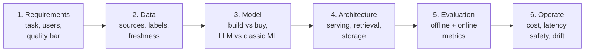
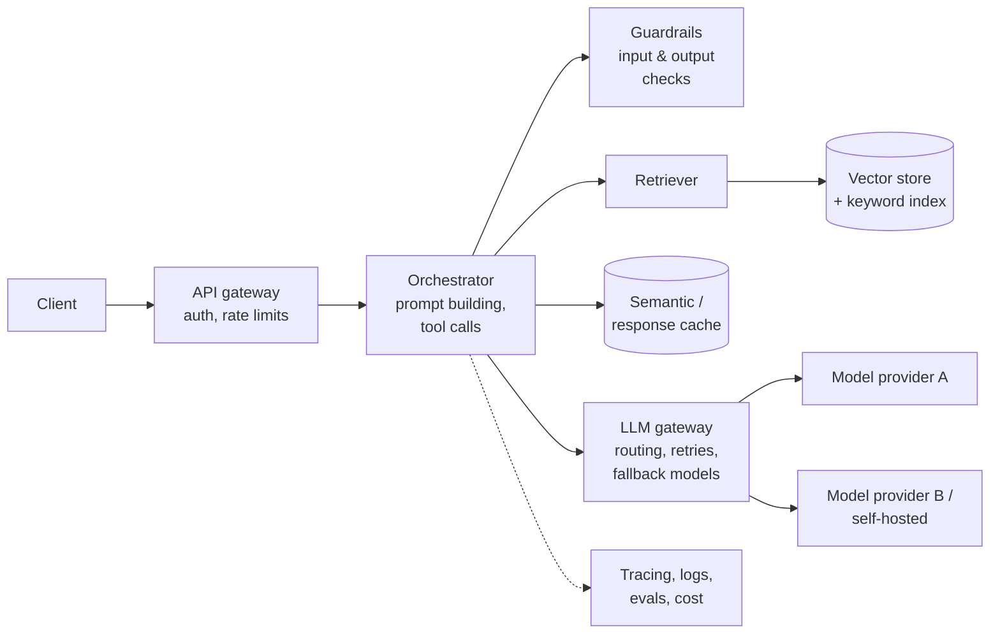
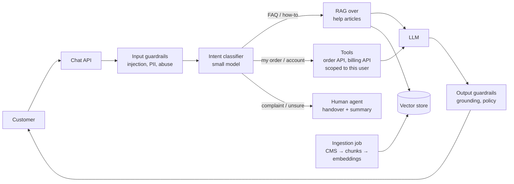
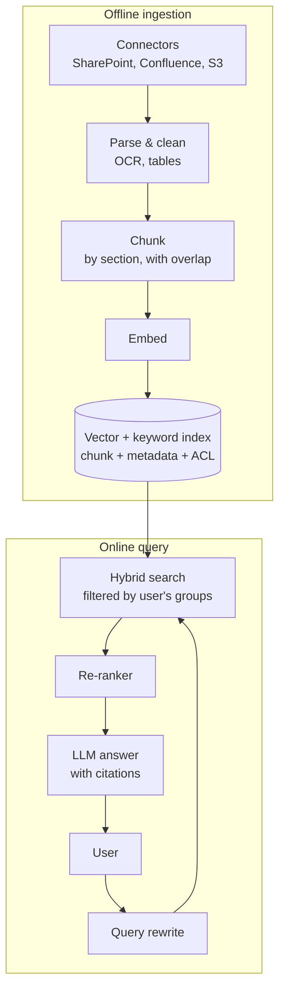
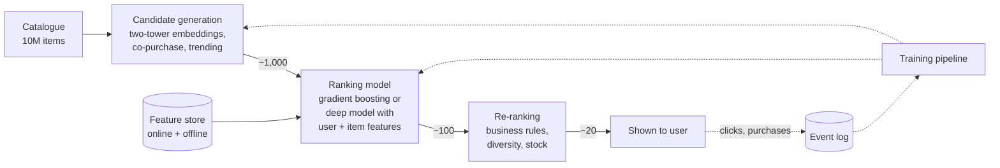
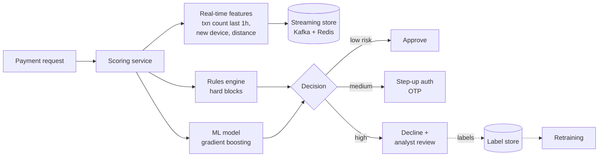
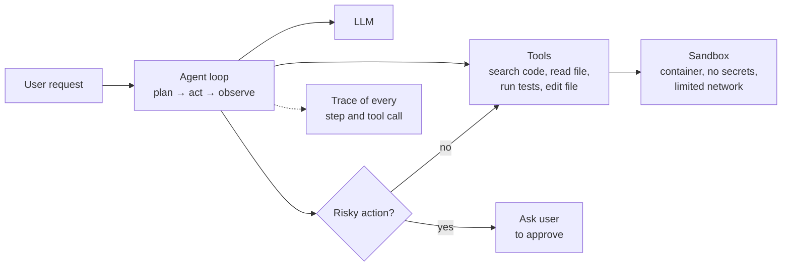

# AI System Design

## Approach

### How do you approach an AI system design question in an interview?

<!-- level: intermediate -->

Use the same structure as a normal system design question, but add the parts that are unique to AI: **data**, **model choice**, **evaluation** and **safety**.



1. **Clarify the problem** – what decision or output does the AI produce, for whom, and what happens when it is wrong?
2. **Data** – where it comes from, how much, how fresh it must be, who owns it and whether it contains personal data
3. **Model** – does this even need ML? Rules, classic ML, a hosted LLM or a fine-tuned model?
4. **Architecture** – online vs batch, retrieval, caching, queues, feature store, vector store
5. **Evaluation** – how you measure quality before launch (offline) and after launch (online)
6. **Operate** – latency, cost per request, monitoring, drift, guardrails and a human fallback

> **Interview tip:** Say early **how you will measure success**. "I'd define an eval set of 200 real questions with expected answers before writing any prompt" signals far more experience than naming a vector database.

### What questions do you ask to clarify requirements for an AI system?

<!-- level: intermediate -->

| Area | Questions |
| --- | --- |
| **Users & task** | Who uses it? What is the exact input and output? Is it assistive (human reviews) or autonomous? |
| **Quality** | What does "good" look like? What is the cost of a wrong answer – annoying, expensive or dangerous? |
| **Scale** | Requests per second, peak traffic, number of documents or items, number of users |
| **Latency** | Interactive (< 2 s, streaming) or batch (minutes to hours)? |
| **Data** | What data exists today? Is it labelled? How often does it change? Any PII or regulated data? |
| **Cost** | Budget per request or per month? |
| **Constraints** | Must it run on-premises or in a region? Approved model providers? Explainability required? |

### When should you *not* use an LLM?

<!-- level: intermediate -->

An LLM is the wrong tool when a cheaper, more predictable option does the job:

- **Deterministic rules work** – validation, routing on known fields, calculations
- **Structured prediction on tabular data** – churn, fraud scoring, demand forecasting are usually better with gradient-boosted trees (XGBoost, LightGBM)
- **Very high volume, very low latency** – millions of requests per second at < 10 ms (ad ranking, spam filtering) need small, specialised models
- **Exact answers are required** – accounting totals, legal identifiers; let code compute them and let the LLM only explain
- **No way to evaluate** – if you cannot measure whether the output is right, you cannot safely ship it

> **Common mistake:** Reaching for an LLM (or an agent) by default. Interviewers reward candidates who start with the simplest solution and justify each step up in complexity.

## Building blocks

### What are the main components of an LLM-based application?

<!-- level: intermediate -->



| Component | Responsibility |
| --- | --- |
| **API gateway** | Authentication, rate limiting, quotas per tenant |
| **Orchestrator** | Builds the prompt, calls tools and retrieval, manages conversation state |
| **Retriever + vector store** | Finds relevant context (RAG) |
| **LLM gateway** | One place for model routing, retries, fallback, timeouts, key management and cost tracking |
| **Guardrails** | Block prompt injection, PII leaks and unsafe output; validate structured output |
| **Cache** | Reuse answers or prompt prefixes to cut cost and latency |
| **Observability** | Trace every request (prompt, retrieved chunks, model, tokens, latency, cost) for debugging and evals |

### Should you build, fine-tune or buy the model?

<!-- level: advanced -->

Climb this ladder only as far as you need to:

| Step | When it is enough | Trade-off |
| --- | --- | --- |
| **Prompting a hosted model** | Most tasks; start here | Fast to build; per-token cost; data leaves your boundary (check terms) |
| **RAG** | The model needs private or fresh knowledge | Extra infrastructure; quality depends on retrieval |
| **Fine-tuning** | Consistent format, tone or a narrow task; prompting has plateaued | Needs labelled data and an eval set; must be redone for new base models |
| **Self-hosting an open-weights model** | Strict data residency, very high volume, or offline use | You own GPUs, scaling, upgrades and safety |
| **Training from scratch** | Almost never | Huge data and compute cost |

> **Interview tip:** "Use RAG for **knowledge**, fine-tuning for **behaviour**" is a short rule interviewers like to hear.

### How do you reduce latency in an LLM application?

<!-- level: advanced -->

- **Stream tokens** to the user so the first words appear quickly (optimise *time to first token*)
- **Use a smaller model** for easy requests and route only hard ones to a large model
- **Shorten prompts** – fewer, better retrieved chunks; trim conversation history
- **Prompt caching** – keep the static part of the prompt (system prompt, tools, documents) at the start so the provider can reuse it
- **Response / semantic caching** for repeated questions
- **Run steps in parallel** – retrieval, guardrail checks and tool calls that don't depend on each other
- **Limit output length** – output tokens are slower than input tokens
- **Move work offline** – pre-compute summaries, embeddings and classifications in batch jobs

### How do you control the cost of an LLM system?

<!-- level: advanced -->

Start with a back-of-the-envelope estimate:

```text
Cost per request  = input tokens × input price + output tokens × output price
Monthly cost      = cost per request × requests per day × 30

Example: 3,000 input + 500 output tokens, 100,000 requests/day
→ 300M input + 50M output tokens per day
```

Then reduce it:

| Lever | Effect |
| --- | --- |
| **Model routing** | Small model for classification and simple answers; large model only when needed |
| **Prompt caching** | Large discount on repeated prompt prefixes |
| **Response caching** | Skip the model entirely for repeated questions |
| **Fewer, better chunks** | Re-ranking lets you send 5 chunks instead of 20 |
| **Batch APIs** | Cheaper for work that can wait (nightly summarisation, labelling) |
| **Per-tenant budgets** | Quotas and alerts stop one customer or a runaway agent loop from burning the budget |

### How do you make an LLM system reliable?

<!-- level: advanced -->

LLM providers have rate limits, outages and slow responses, and the model itself is non-deterministic. Treat it like any other unreliable dependency:

- **Timeouts and retries** with exponential backoff and jitter
- **Fallback models** – a second provider or region behind the LLM gateway
- **Queues** for non-interactive work so spikes are absorbed instead of rejected
- **Structured output** – ask for JSON against a schema, validate it, and retry once on failure
- **Graceful degradation** – show search results without a generated answer, or hand over to a human
- **Idempotent tool calls** so a retried request doesn't, for example, refund a customer twice
- **Pin model versions** and run your eval suite before switching to a new version

## Classic design questions

### Design a customer support chatbot for a company's help centre

<!-- level: advanced -->

**Requirements:** Answer customer questions from help articles and the customer's own account data; hand over to a human agent when unsure; 50,000 conversations a day; answers in under 3 seconds (streamed).



**Key design points:**

- **Ingestion pipeline** – when a help article changes, re-chunk and re-embed only that article; store article ID, URL and version with each chunk
- **Hybrid search + re-ranking** – keyword search catches product codes and error numbers that embeddings miss
- **Tools are scoped to the signed-in user** – the model never receives an ID it could swap for another customer's
- **Citations** – show which articles the answer came from, so customers and reviewers can check it
- **Escalation rules** – low retrieval scores, negative sentiment, refund requests above a limit, or the user asking for a person
- **Evaluation** – offline: a golden set of real questions graded for correctness and groundedness; online: resolution rate, escalation rate, thumbs up/down, repeat contact within 7 days

> **Interview tip:** Mention the **handover to a human** early. It shows you understand that the cost of a wrong answer in support is a lost customer, not just a bad response.

### Design an enterprise document Q&A system (RAG over internal documents)

<!-- level: advanced -->

**Requirements:** Employees ask questions over 5 million documents (SharePoint, Confluence, PDFs); answers must respect each user's existing permissions; documents change daily.



| Concern | Design decision |
| --- | --- |
| **Permissions** | Store the document's access list (groups) as metadata on every chunk and **filter at query time** with the user's groups; never rely on the prompt to hide data |
| **Freshness** | Change feeds / webhooks from each source for incremental updates; deletes must remove chunks too |
| **Chunking** | Split by headings and paragraphs, keep the title and section path in each chunk |
| **Scale** | 5M documents × ~20 chunks = ~100M vectors; use approximate nearest neighbour (HNSW) indexes, shard by tenant or source |
| **Quality** | Hybrid search, re-ranking, query rewriting for follow-up questions |
| **Trust** | Citations with links; answer "I don't know" when retrieval scores are low |
| **Evaluation** | Retrieval metrics (recall@k, MRR) and answer metrics (faithfulness, relevance) on a labelled question set |

> **Common mistake:** Building one shared index and asking the LLM to "only use documents the user can access". Access control must be enforced **before** the data reaches the model.

### Design a recommendation system (e.g. for an e-commerce site)

<!-- level: advanced -->

Large recommendation systems use a **multi-stage funnel**, because you cannot score millions of items for every request in under 100 ms:



- **Candidate generation** – cheap and broad: embedding similarity (ANN search), "bought together", popular in category
- **Ranking** – expensive and precise: predicts click or purchase probability using user history, item features and context (time, device)
- **Re-ranking** – applies business rules: remove out-of-stock items, add diversity, boost promotions
- **Feature store** – the same feature definitions for training (offline) and serving (online) to avoid **training–serving skew**
- **Cold start** – new users get popular or contextual items; new items use content features (text and image embeddings)
- **Evaluation** – offline: precision@k, NDCG, recall; online: **A/B test** on click-through rate, conversion and revenue per session

### Design a fraud detection system for card payments

<!-- level: advanced -->

**Requirements:** Score every transaction in under 100 ms; fraud is under 0.1% of transactions; fraud patterns change quickly.



- **Rules + model** – rules catch known patterns instantly and are explainable; the model catches subtle ones
- **Imbalanced data** – use precision–recall, not accuracy (99.9% accuracy means nothing); tune the threshold on the cost of a missed fraud vs a blocked good customer
- **Real-time features** from a stream (Kafka/Flink) – velocity features matter more than the model choice
- **Delayed labels** – chargebacks arrive weeks later, so evaluate on time-based splits and monitor drift in the meantime
- **Explainability** – store the top reasons for each decision for analysts and regulators
- **Fail open or closed?** – if the model is down, fall back to rules rather than blocking all payments

### Design an AI coding assistant or agent that can take actions

<!-- level: advanced -->



- **Tools with narrow permissions** – read-only tools by default; writes, deletes, deployments and payments need explicit approval
- **Sandboxing** – run code in an isolated container with no production credentials
- **Step and budget limits** – maximum iterations, tokens and wall-clock time, so a loop cannot run forever
- **Context management** – search the repository instead of putting everything in the prompt; summarise long histories
- **Prompt injection** – treat file contents, web pages and tool output as **data, not instructions**
- **Evaluation** – a benchmark of real tasks with automatic checks (do the tests pass?), plus success rate, cost and steps per task

> **Interview tip:** For any agent design, say what the agent is **not** allowed to do and how a human stays in control. That is usually the part the interviewer cares about most.

### Design a content moderation system for user posts

<!-- level: advanced -->

- **Layered pipeline** – hash matching for known bad content → fast small classifiers on every post → an LLM or larger model only for borderline cases → human reviewers for the hardest cases and appeals
- **Thresholds per category** – stricter for violence or child safety, looser for mild profanity
- **Asynchronous by default** – publish low-risk posts immediately and scan in the background; hold high-risk posts for review
- **Multi-modal** – text, image and video models; OCR for text inside images
- **Feedback loop** – reviewer decisions become training labels; track precision and recall per category and per language
- **Policy changes** – an LLM with the policy in the prompt can adapt faster than retraining a classifier, at higher cost per item

## Evaluation and operations

### How do you evaluate an AI system before and after launch?

<!-- level: advanced -->

| Stage | What you measure | How |
| --- | --- | --- |
| **Offline (before launch)** | Accuracy, precision/recall, groundedness, format validity | Golden dataset of real examples, automatic checks, LLM-as-judge with a rubric, human review of a sample |
| **Shadow / canary** | Same metrics on live traffic, latency, cost | Run the new version alongside the old one without showing results, then to a small % of users |
| **Online (after launch)** | Business metrics – resolution rate, conversion, time saved – and user feedback | A/B tests, thumbs up/down, escalation rate |
| **Regression** | Did a prompt, model or data change break something? | Run the eval suite in CI on every change |

> **Note:** LLM-as-judge is useful but biased (it prefers longer answers and its own style). Calibrate it against human labels before trusting it.

### What do you monitor in a production AI system?

<!-- level: advanced -->

- **System metrics** – latency (p50/p95/p99, time to first token), error rate, rate-limit hits, throughput
- **Cost** – tokens and spend per request, per feature and per tenant
- **Quality** – sampled outputs scored by automatic evals, user feedback, escalation rate
- **Data drift** – the inputs change (new products, new slang, new fraud patterns)
- **Concept drift** – the relationship between input and correct output changes, so accuracy falls
- **Safety** – guardrail triggers, prompt injection attempts, PII detections

### How do you secure an AI system?

<!-- level: advanced -->

| Risk | Mitigation |
| --- | --- |
| **Prompt injection** (direct or hidden in documents and web pages) | Separate instructions from data, least-privilege tools, human approval for risky actions, injection classifiers |
| **Data leakage between users** | Access control on retrieval and tools, never in the prompt; tenant isolation |
| **Sensitive data sent to providers** | PII redaction, approved providers with no-training agreements, regional deployment |
| **Insecure output handling** | Treat model output as untrusted – escape it in HTML, validate it before running SQL or code |
| **Denial of wallet** | Rate limits, token budgets, maximum agent steps |
| **Model or data poisoning** | Trusted data sources, review of training and RAG content, versioned datasets |

See the [OWASP Top 10 for LLM Applications](https://owasp.org/www-project-top-10-for-large-language-model-applications/) for the full list.
