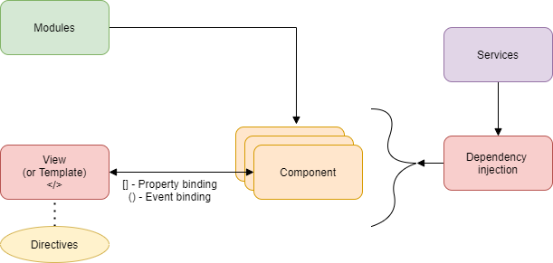
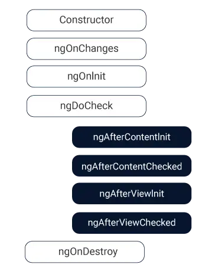

# Angular

## Basics

### What is Angular used for?

Angular is a JavaScript binding framework that binds the HTML UI to a JavaScript model.

- It helps you build SPAs (single page applications) using routing
- It has many other built-in features – HTTP, DI, `@Input`, `@Output` and more – so you don't need other frameworks

### What is the difference between AngularJS and Angular?

| | AngularJS | Angular |
| --- | --- | --- |
| Language | JavaScript | TypeScript |
| Architecture | Controller | Component |
| CLI | No | Yes |
| Lazy loading | No | Yes |
| Server-side rendering | No | Yes |

### What is TypeScript and why do we need it?

- TypeScript is a superset of JavaScript that adds static types
- It provides an object-oriented programming environment that transpiles (converts) to JavaScript
- Because it is strongly typed, errors are caught at compile time

### What is the importance of the Angular CLI?

The Angular CLI is a command-line interface for creating the initial Angular project template, and for generating components, services, modules and so on.

```bash
npm install -g @angular/cli
ng new project-app
```

### What is the architecture of Angular?



- **Template** – the HTML view
- **Component** – binds the view and the model
- **Module** – groups components logically
- **Binding** – defines how the view and component communicate
- **Directive** – changes the behaviour of the HTML DOM
- **Service** – shares common logic across the project
- **DI** – dependency injection injects instances through the constructor

## Components, modules and templates

### What are components and modules?

- A **component** is where you write your binding code
- A **module** logically groups components

Create a component with `@Component` and a module with `@NgModule`.

### What are annotations or metadata?

They are **decorators** – e.g. `@Component`, `@NgModule`, `@Injectable` – that attach metadata to a class.

### What is a template?

A template is the HTML view of an Angular component, in which you can use directives and bindings.

There are two types:

- **Inline** – written in the `template` property
- **Separate HTML file** – referenced by the `templateUrl` property

### What are the four types of data binding in Angular?

| Binding | Syntax | Direction |
| --- | --- | --- |
| Interpolation | `{{ value }}` | Component → UI |
| Property binding | `[property]="value"` | Component → UI |
| Event binding | `(event)="handler()"` | UI → component |
| Two-way binding | `[(ngModel)]="value"` | Both ways |

## Directives

### What are directives in Angular?

Directives are instructions applied to HTML elements that change their appearance, behaviour or the DOM layout.

### What are the different types of directives?

Mnemonic: **SAC** – Structural, Attribute, Component.

**Structural** – changes the DOM layout by adding and removing elements:

```html
<tr *ngFor="let cust of customerModels">
    <td>{{ cust.CustomerCode }}</td>
    <td>{{ cust.CustomerName }}</td>
    <td>{{ cust.CustomerAmount }}</td>
</tr>
```

**Attribute** – changes the appearance and behaviour of HTML elements:

```html
<div [hidden]="hide()">Customer code format is not proper</div>
```

**Component** – a directive with a template; similar to a user control:

```html
<my-grid></my-grid>
```

A component uses the `@Component` decorator:

```ts
@Component({
  selector: 'my-grid',
  templateUrl: './grid.component.html'
})
export class GridComponent { }
```

### What are `ViewChild` and `ViewChildren`?

`ViewChild` references an element or child component from the view in its component class.

`ViewChild` references **one** object, while `ViewChildren` references a **collection**.

```html
<div #div1>This is div1</div>
```

```ts
export class Comp1 {
  @ViewChild('div1') div1: ElementRef;
}
```

### Why do we need template reference variables?

A template reference variable gives a reference to a DOM element, component, directive or web component within the template.

```html
<div #div1>This is div1</div>
{{ div1.textContent }}
```

### What is content projection?

Content projection lets a parent component project content into a child component.

```html
<ng-content></ng-content>
```

### What is a content projection slot?

A slot projects specific content into a specific place in the child component.

```html
<ng-content select="[slot1]"></ng-content>
```

## Routing and lazy loading

### What is an SPA?

A single page application – the main UI is loaded once, and the rest of the UI is loaded on demand.

### How do you implement an SPA in Angular?

Through routing.

### What is routing?

- Routing is a collection of pairs, each with a URL and a component
- When the URL is called, the matching component is loaded

### How do you implement routing?

1. Define the routing collection in `app-routing.module.ts`
2. Add `<router-outlet></router-outlet>` where the component should be loaded
3. Use `routerLink` to navigate

### What is lazy loading?

Lazy loading means on-demand loading – loading only the HTML, CSS and JavaScript that is needed, for better performance.

### How do you implement lazy loading?

**Step 1:** Create a separate module for each feature:

```bash
ng g module Customer/Customer --flat=true --routing=true
ng g module Supplier/Supplier --flat=true --routing=true
```

**Step 2:** Use `loadChildren` in `app-routing.module.ts`:

```ts
const routes: Routes = [
  { path: 'Home', component: HomeComponent },
  { path: 'Customer', loadChildren: () => import('./Customer/customer.module').then(m => m.CustomerModule) },
  { path: 'Supplier', loadChildren: () => import('./Supplier/supplier.module').then(m => m.SupplierModule) },
  { path: '', component: HomeComponent }
];
```

> **Note:** Before Angular 8, `loadChildren` used a string: `'./Customer/customer.module#CustomerModule'`.

**Step 3:** Add the route in the child routing module:

```ts
const routes: Routes = [
  { path: '', component: SupplierComponent }
];
```

## Services and dependency injection

### What are services?

Services share common logic across an Angular project.

### What is dependency injection?

Dependency injection means the component does not create object instances itself – Angular injects them, through the constructor.

There are two types of DI:

- Centralised DI
- Conditional DI

### How do you implement dependency injection?

**Step 1:** Create the logger classes:

```ts
export interface ILogger {
    log(): void;
}

export class BaseLogger implements ILogger {
    log() { }
}

export class ConsoleLogger extends BaseLogger {
    log() {
        console.log("Console logger");
    }
}

export class DbLogger extends BaseLogger {
    log() {
        console.log("DB logger");
    }
}
```

**Step 2:** Register `BaseLogger` in `app.module.ts`:

```ts
providers: [
    // Centralised DI
    { provide: BaseLogger, useClass: DbLogger },
]
```

**Step 3:** Inject it in the component:

```ts
export class CustomerComponent implements OnInit {
  logObj: BaseLogger;

  constructor(log: BaseLogger) {
    this.logObj = log;
    this.logObj.log();
  }
}
```

For **conditional DI**, register multiple providers in `app.module.ts`:

```ts
providers: [
    // Centralised DI
    { provide: BaseLogger, useClass: ConsoleLogger },

    // Conditional DI
    { provide: '1', useClass: ConsoleLogger },
    { provide: '2', useClass: DbLogger },
],
```

and resolve the one you need in the component with `Injector`:

```ts
logObj: BaseLogger;

constructor(injector: Injector) {
    this.logObj = injector.get('1');
    this.logObj.log();
}
```

### What is the benefit of dependency injection?

- Decoupled classes
- Easier unit testing, because dependencies can be mocked

## Component life cycle

### What are the events and sequence of the component life cycle?

The three most commonly used hooks:

| Life cycle hook | Purpose |
| --- | --- |
| `ngOnChanges` | Runs every time the value of an input property changes. Receives a `SimpleChanges` object with the current and previous values. |
| `ngOnInit` | Runs once, after the constructor and the first `ngOnChanges`. Most commonly used for component initialisation and loading data. |
| `ngOnDestroy` | Runs just before the component is destroyed. Used for clean-up, such as unsubscribing. |



### What is the difference between the constructor and `ngOnInit()`?

| Constructor | `ngOnInit()` |
| --- | --- |
| TypeScript concept | Angular concept |
| Initialises class variables | Fires after the UI is bound to the component |
| Used for DI | Used for loading the UI / data |

## Build

### What is the difference between `ng serve` and `ng build`?

- `ng serve` – builds the app in memory and serves it with a development server
- `ng build` – builds the app and writes the output to disk (the `dist` folder)

### What does the `--prod` parameter in `ng build` do?

It creates a production build: minified and compressed JavaScript, ahead-of-time (AOT) compilation and tree-shaking.

> **Note:** From Angular 12, use `ng build --configuration production` (the default for `ng build`).
