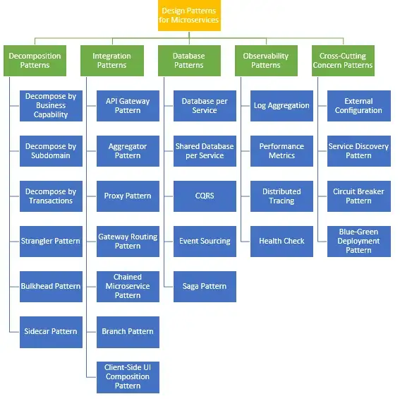

# Design Patterns

## In practice

### Which design patterns have you used in your project?

It depends on the project. Commonly used patterns:

- **CQRS**, usually combined with the **Mediator** pattern
- **Repository** – and when you use repositories, the **Unit of Work** pattern
- **Factory** – to centralise object creation
- **Decorator** – for dynamic validation
- **Adapter**, **Strategy**, **Bridge** and so on

### Which design patterns are used in a microservice project?

## Gang of Four patterns

### What are the creational patterns?

| Pattern | One-line definition |
| --- | --- |
| Abstract Factory | Creates an instance of several families of classes |
| Builder | Separates object construction from its representation |
| Factory Method | Creates an instance of several derived classes |
| Prototype | A fully initialised instance to be copied or cloned |
| Singleton | A class of which only a single instance can exist |

### What are the structural patterns?

| Pattern | One-line definition |
| --- | --- |
| Adapter | Matches interfaces of different classes |
| Bridge | Separates an object's abstraction from its implementation |
| Composite | A tree structure of simple and composite objects |
| Decorator | Adds responsibilities to objects dynamically |
| Façade | A single class that represents an entire subsystem |
| Flyweight | A fine-grained instance used for efficient sharing |
| Proxy | An object representing another object |

### What are the behavioural patterns?

| Pattern | One-line definition |
| --- | --- |
| Chain of Responsibility | Passes a request along a chain of objects |
| Command | Encapsulates a command request as an object |
| Interpreter | A way to include language elements in a program |
| Iterator | Sequentially accesses the elements of a collection |
| Mediator | Defines simplified communication between classes |
| Memento | Captures and restores an object's internal state |
| Observer | Notifies a number of classes of a change |
| State | Alters an object's behaviour when its state changes |
| Strategy | Encapsulates an algorithm inside a class |
| Template Method | Defers the exact steps of an algorithm to a subclass |
| Visitor | Defines a new operation on a class without changing it |
