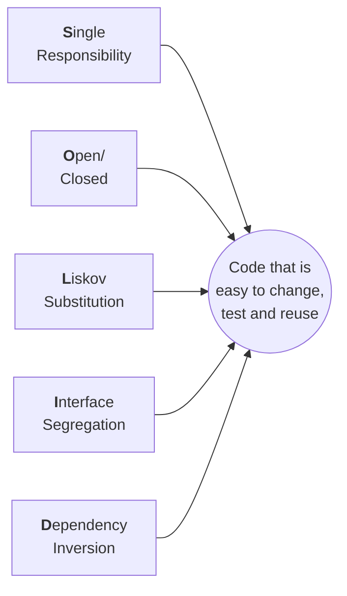
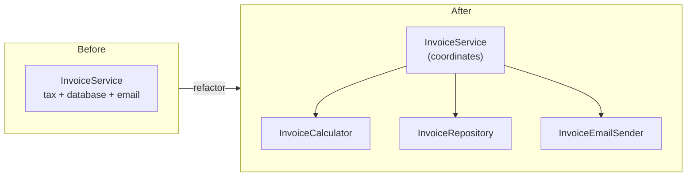
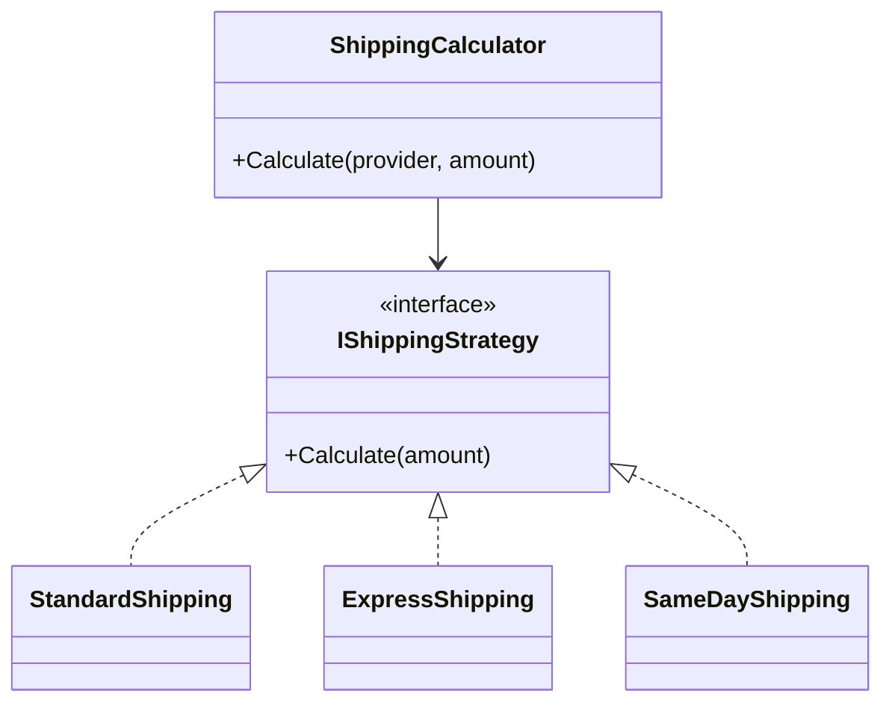
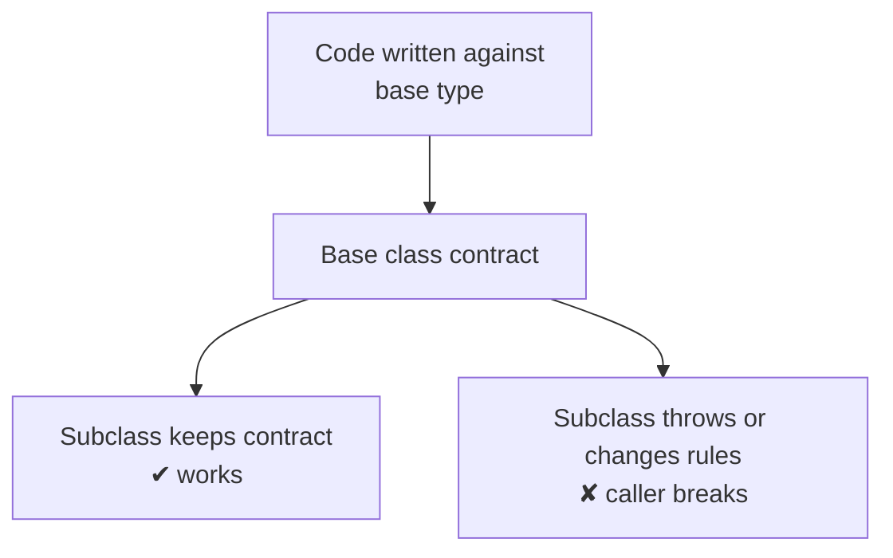
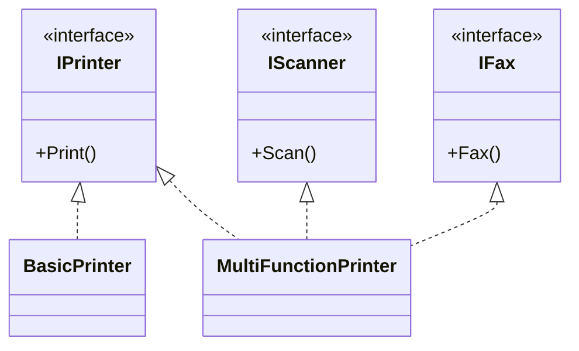
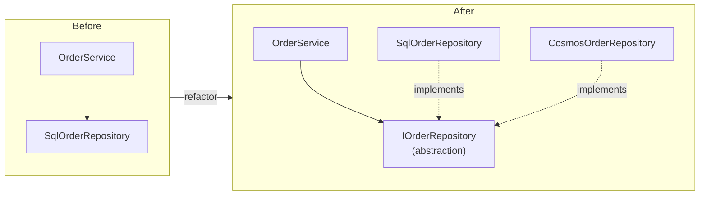
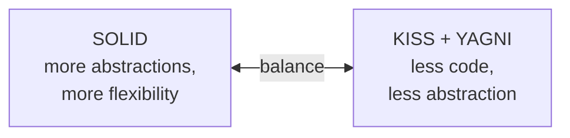
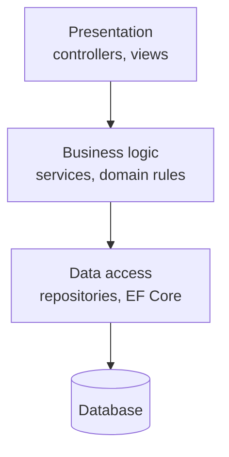
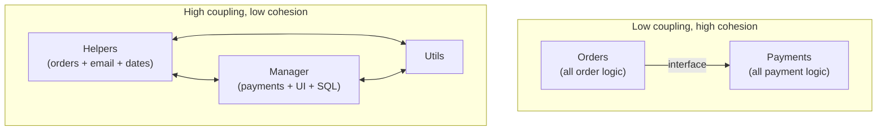

# Design Principles

## Overview

### What are design principles, and why do they matter?

<!-- level: beginner -->

Design principles are **guidelines for structuring code so that it stays easy to change**. They are not rules a compiler checks; they are habits that keep code loosely coupled, easy to test and easy to read.

Most of them try to achieve two things:

- **Low coupling** – a class knows as little as possible about other classes, so a change in one place does not ripple everywhere
- **High cohesion** – everything inside a class belongs together and serves one purpose

The most commonly asked principles are:

| Principle | One-line meaning |
| --- | --- |
| **SOLID** | Five principles for object-oriented design, popularised by Robert C. Martin ("Uncle Bob") |
| **DRY** | Don't Repeat Yourself – keep each piece of knowledge in one place |
| **KISS** | Keep It Simple, Stupid – prefer the simplest solution that works |
| **YAGNI** | You Aren't Gonna Need It – don't build features before they are needed |
| **Composition over inheritance** | Build behaviour by combining objects rather than deep class hierarchies |
| **Separation of Concerns** | Split a program into parts that each handle one concern |
| **Law of Demeter** | Talk only to your immediate friends, not to strangers |

### What problems appear when design principles are ignored?

<!-- level: beginner -->

Robert C. Martin describes four symptoms of a "rotting" design:

| Symptom | What it looks like |
| --- | --- |
| **Rigidity** | A small change forces changes in many other classes |
| **Fragility** | Fixing one bug creates new bugs in unrelated places |
| **Immobility** | Code cannot be reused elsewhere because it is tangled with its dependencies |
| **Viscosity** | Doing it the right way is harder than hacking it, so people hack it |

In day-to-day terms: tightly coupled code, duplicated logic, classes that cannot be unit tested, and long, risky releases.

> **Interview tip:** Principles are means, not goals. Say that you apply them **where change is likely** – over-applying SOLID to a simple script just adds interfaces and files nobody needs.

## SOLID

### What does SOLID stand for?

<!-- level: beginner -->

| Letter | Principle | One line |
| --- | --- | --- |
| **S** | Single Responsibility | A class should have only one reason to change |
| **O** | Open/Closed | Open for extension, closed for modification |
| **L** | Liskov Substitution | A subtype must be usable wherever its base type is expected |
| **I** | Interface Segregation | Clients should not depend on methods they don't use |
| **D** | Dependency Inversion | Depend on abstractions, not on concrete classes |



### What is the Single Responsibility Principle (SRP)?

<!-- level: beginner -->

**A class should have only one reason to change.** "Reason to change" means one actor or one area of the business – not "one method".

**Before** – `InvoiceService` calculates the total, saves to the database and sends email. A change to the email template, the database schema or the tax rule all touch the same class:

```csharp
public class InvoiceService
{
    public void Process(Invoice invoice)
    {
        invoice.Total = invoice.Lines.Sum(l => l.Price * l.Quantity) * 1.18m; // tax rule

        using var connection = new SqlConnection("...");                      // persistence
        connection.Execute("INSERT INTO Invoices ...", invoice);

        var smtp = new SmtpClient("smtp.company.com");                        // notification
        smtp.Send("billing@company.com", invoice.CustomerEmail, "Your invoice", "...");
    }
}
```

**After** – each responsibility lives in its own class, and `InvoiceService` only coordinates them:

```csharp
public class InvoiceCalculator
{
    public decimal CalculateTotal(Invoice invoice) =>
        invoice.Lines.Sum(l => l.Price * l.Quantity) * 1.18m;
}

public class InvoiceRepository
{
    public void Save(Invoice invoice) { /* database code */ }
}

public class InvoiceEmailSender
{
    public void Send(Invoice invoice) { /* email code */ }
}

public class InvoiceService
{
    private readonly InvoiceCalculator _calculator;
    private readonly InvoiceRepository _repository;
    private readonly InvoiceEmailSender _emailSender;

    public InvoiceService(InvoiceCalculator calculator, InvoiceRepository repository, InvoiceEmailSender emailSender)
    {
        _calculator = calculator;
        _repository = repository;
        _emailSender = emailSender;
    }

    public void Process(Invoice invoice)
    {
        invoice.Total = _calculator.CalculateTotal(invoice);
        _repository.Save(invoice);
        _emailSender.Send(invoice);
    }
}
```



> **Common mistake:** Saying SRP means "a class should have only one method". An `InvoiceRepository` with `Save`, `GetById` and `Delete` still has one responsibility – persistence.

### What is the Open/Closed Principle (OCP)?

<!-- level: intermediate -->

**Software entities should be open for extension but closed for modification.** You add new behaviour by adding new code, not by editing code that already works and is tested.

**Before** – every new shipping provider means editing this method and re-testing all the existing branches:

```csharp
public class ShippingCalculator
{
    public decimal Calculate(string provider, decimal orderAmount)
    {
        if (provider == "Standard") return orderAmount * 0.05m;
        if (provider == "Express")  return orderAmount * 0.10m;
        // adding "SameDay" means modifying this class
        throw new ArgumentException("Unknown provider");
    }
}
```

**After** – each provider is a separate class behind an interface. Adding `SameDayShipping` needs no change to existing classes:

```csharp
public interface IShippingStrategy
{
    string Name { get; }
    decimal Calculate(decimal orderAmount);
}

public class StandardShipping : IShippingStrategy
{
    public string Name => "Standard";
    public decimal Calculate(decimal orderAmount) => orderAmount * 0.05m;
}

public class ExpressShipping : IShippingStrategy
{
    public string Name => "Express";
    public decimal Calculate(decimal orderAmount) => orderAmount * 0.10m;
}

public class SameDayShipping : IShippingStrategy   // new behaviour, new class
{
    public string Name => "SameDay";
    public decimal Calculate(decimal orderAmount) => orderAmount * 0.20m + 50;
}

public class ShippingCalculator
{
    private readonly IEnumerable<IShippingStrategy> _strategies;

    public ShippingCalculator(IEnumerable<IShippingStrategy> strategies) => _strategies = strategies;

    public decimal Calculate(string provider, decimal orderAmount) =>
        _strategies.Single(s => s.Name == provider).Calculate(orderAmount);
}
```



> **Interview tip:** Mention that OCP is usually achieved with the **Strategy** pattern, plugins or dependency injection, and that a growing `if/else` or `switch` on a type is the classic sign it is being broken.

### What is the Liskov Substitution Principle (LSP)?

<!-- level: advanced -->

**Objects of a subclass must be usable wherever the base class is expected, without breaking the program.** A subclass may add behaviour, but it must keep the promises (the contract) of its parent.

A subclass breaks LSP when it:

- Throws `NotImplementedException` or `NotSupportedException` for a base method
- Requires stronger inputs than the parent (stronger preconditions)
- Returns weaker results than the parent promised (weaker postconditions)
- Changes state the parent guarantees stays the same

**Before** – the classic rectangle and square problem. Mathematically a square *is a* rectangle, but in code it breaks the caller:

```csharp
public class Rectangle
{
    public virtual int Width { get; set; }
    public virtual int Height { get; set; }
    public int Area => Width * Height;
}

public class Square : Rectangle
{
    public override int Width  { set { base.Width = value; base.Height = value; } }
    public override int Height { set { base.Width = value; base.Height = value; } }
}

// Caller written against Rectangle
void Resize(Rectangle r)
{
    r.Width = 5;
    r.Height = 4;
    Debug.Assert(r.Area == 20);   // fails for Square: Area is 16
}
```

**After** – don't force the "is a" relationship. Both shapes share a smaller contract that each can honour fully:

```csharp
public interface IShape
{
    int Area { get; }
}

public record Rectangle(int Width, int Height) : IShape
{
    public int Area => Width * Height;
}

public record Square(int Side) : IShape
{
    public int Area => Side * Side;
}
```

A second common example is payments: if `CashOnDelivery` inherits from a `Payment` class that has `Refund()` to a card, it has to throw. The fix is to move `Refund()` to an `IRefundable` interface that only card payments implement.



> **Interview tip:** A one-line test for LSP: *"If I replace the parent with this child, do all the parent's unit tests still pass?"* If not, the inheritance is wrong.

### What is the Interface Segregation Principle (ISP)?

<!-- level: intermediate -->

**Clients should not be forced to depend on methods they do not use.** Prefer several small, focused interfaces over one large "fat" interface.

**Before** – a basic printer must implement fax and scan, so it throws:

```csharp
public interface IMachine
{
    void Print(Document document);
    void Scan(Document document);
    void Fax(Document document);
}

public class BasicPrinter : IMachine
{
    public void Print(Document document) { /* print */ }
    public void Scan(Document document) => throw new NotSupportedException();
    public void Fax(Document document)  => throw new NotSupportedException();
}
```

**After** – split the interface by role. Each class implements only what it can actually do:

```csharp
public interface IPrinter { void Print(Document document); }
public interface IScanner { void Scan(Document document); }
public interface IFax     { void Fax(Document document); }

public class BasicPrinter : IPrinter
{
    public void Print(Document document) { /* print */ }
}

public class MultiFunctionPrinter : IPrinter, IScanner, IFax
{
    public void Print(Document document) { /* print */ }
    public void Scan(Document document)  { /* scan */ }
    public void Fax(Document document)   { /* fax */ }
}
```



> **Note:** ISP and LSP are related. A fat interface often *causes* LSP violations, because implementers end up throwing `NotSupportedException`.

### What is the Dependency Inversion Principle (DIP)?

<!-- level: intermediate -->

Two rules:

1. **High-level modules should not depend on low-level modules. Both should depend on abstractions.**
2. **Abstractions should not depend on details. Details should depend on abstractions.**

**Before** – `OrderService` (business logic) creates `SqlOrderRepository` and `FileLogger` itself. It cannot be unit tested without a database, and switching to another store means editing it:

```csharp
public class OrderService
{
    private readonly SqlOrderRepository _repository = new SqlOrderRepository();
    private readonly FileLogger _logger = new FileLogger();

    public void PlaceOrder(Order order)
    {
        _repository.Save(order);
        _logger.Log($"Order {order.Id} placed");
    }
}
```

**After** – `OrderService` depends on interfaces it owns. The concrete classes are passed in (dependency injection):

```csharp
public interface IOrderRepository { void Save(Order order); }
public interface ILogger { void Log(string message); }

public class OrderService
{
    private readonly IOrderRepository _repository;
    private readonly ILogger _logger;

    public OrderService(IOrderRepository repository, ILogger logger)
    {
        _repository = repository;
        _logger = logger;
    }

    public void PlaceOrder(Order order)
    {
        _repository.Save(order);
        _logger.Log($"Order {order.Id} placed");
    }
}

public class SqlOrderRepository : IOrderRepository { public void Save(Order order) { /* SQL */ } }
public class CosmosOrderRepository : IOrderRepository { public void Save(Order order) { /* Cosmos DB */ } }
public class FileLogger : ILogger { public void Log(string message) { /* file */ } }
```

Wiring it up in ASP.NET Core:

```csharp
builder.Services.AddScoped<IOrderRepository, SqlOrderRepository>();
builder.Services.AddSingleton<ILogger, FileLogger>();
builder.Services.AddScoped<OrderService>();
```

The arrow of dependency is **inverted** – the low-level SQL class now points at the abstraction defined by the business layer:



### What is the difference between Dependency Inversion, Dependency Injection and Inversion of Control?

<!-- level: intermediate -->

They are often mixed up in interviews:

| Term | What it is | Example |
| --- | --- | --- |
| **Dependency Inversion Principle (DIP)** | A *design principle* – depend on abstractions | `OrderService` depends on `IOrderRepository` |
| **Dependency Injection (DI)** | A *technique* – pass dependencies in from outside, usually via the constructor | `new OrderService(repository, logger)` |
| **Inversion of Control (IoC)** | A *broader idea* – a framework controls the flow and creates objects, not your code | The ASP.NET Core DI container, event handlers |
| **IoC container** | A *tool* that implements DI automatically | `Microsoft.Extensions.DependencyInjection`, Autofac |

> **Interview tip:** A compact answer: *"DIP is the principle, DI is one way to achieve it, and an IoC container is the tool that does the injection for me."*

## Other principles

### What is DRY?

<!-- level: beginner -->

**Don't Repeat Yourself** – *"Every piece of knowledge must have a single, unambiguous representation in the system"* (from *The Pragmatic Programmer*).

**Before** – the same discount rule is copied in two places. When the rule changes, one copy gets missed:

```csharp
public decimal CartTotal(Cart cart) =>
    cart.IsPremium ? cart.Amount * 0.9m : cart.Amount;

public decimal InvoiceTotal(Invoice invoice) =>
    invoice.IsPremium ? invoice.Amount * 0.9m : invoice.Amount;
```

**After** – the rule lives in one place:

```csharp
public static class Discount
{
    public static decimal Apply(decimal amount, bool isPremium) =>
        isPremium ? amount * 0.9m : amount;
}
```

> **Common mistake:** Merging code that only *looks* the same. If two pieces of code change for different reasons, they are not duplicates, and forcing them together creates coupling. A common rule of thumb is the **rule of three** – wait until you see the third copy before extracting.

### What is KISS?

<!-- level: beginner -->

**Keep It Simple, Stupid** – prefer the simplest solution that solves the problem. Simple code is easier to read, test and debug.

```csharp
// Over-engineered
public bool IsEven(int number) =>
    new NumberParityStrategyFactory().Create(number).Evaluate(number) == Parity.Even;

// Simple
public bool IsEven(int number) => number % 2 == 0;
```

Signs that KISS is being broken: a pattern used "just in case", abstractions with one implementation and no plan for a second, or code that needs a long comment to explain what it does.

### What is YAGNI?

<!-- level: beginner -->

**You Aren't Gonna Need It** – don't build functionality until it is actually needed. It comes from Extreme Programming (XP).

For example, if the requirement is "export orders to CSV", don't build a pluggable export framework supporting PDF, Excel and XML. Build the CSV export; refactor when a second format is really requested.

| Without YAGNI | With YAGNI |
| --- | --- |
| Time spent on features nobody uses | Time spent on what users asked for |
| More code to test and maintain | Smaller, simpler codebase |
| Guesses baked into the design | Design driven by real requirements |

> **Note:** YAGNI is about *features*, not about quality. Writing tests, logging and clean code is still needed now.

### How do DRY, KISS and YAGNI relate to SOLID? Can they conflict?

<!-- level: intermediate -->

Yes, they pull in different directions, and good design is about balance:



- Applying **OCP** everywhere adds interfaces "in case" behaviour changes – which breaks **YAGNI**
- Applying **DRY** aggressively creates shared helpers that couple unrelated features – which breaks **SRP**
- A practical approach: start simple (**KISS / YAGNI**), and introduce **SOLID** abstractions when a second variation or a real need for testing appears

> **Interview tip:** Interviewers like this answer because it shows judgement: *"I don't add an interface until I have a second implementation or need to mock it in a test."*

### What is "composition over inheritance"?

<!-- level: intermediate -->

**Build behaviour by combining small objects (has-a), rather than inheriting from a base class (is-a).** Inheritance creates a tight, compile-time link between parent and child; composition lets you swap behaviour at run time.

**Inheritance** – every combination needs a new subclass, and the hierarchy explodes:

```text
Notifier
├── EmailNotifier
├── SmsNotifier
├── EmailAndSmsNotifier
└── EmailAndSmsAndSlackNotifier ...
```

**Composition** – one class holds a list of channels:

```csharp
public interface INotificationChannel
{
    void Send(string message);
}

public class EmailChannel : INotificationChannel { public void Send(string message) { /* email */ } }
public class SmsChannel   : INotificationChannel { public void Send(string message) { /* SMS */ } }
public class SlackChannel : INotificationChannel { public void Send(string message) { /* Slack */ } }

public class Notifier
{
    private readonly IEnumerable<INotificationChannel> _channels;

    public Notifier(IEnumerable<INotificationChannel> channels) => _channels = channels;

    public void Notify(string message)
    {
        foreach (var channel in _channels)
            channel.Send(message);
    }
}
```

Use inheritance when there is a true, stable "is-a" relationship and the subclass honours the parent's contract (see LSP). Otherwise, prefer composition.

### What is Separation of Concerns?

<!-- level: beginner -->

**Split a program into distinct parts, each dealing with one concern** – for example presentation, business logic and data access. Each part can then change, be tested and be understood on its own.



SRP applies this idea to a single class; layered architecture, MVC and Clean Architecture apply it to a whole application.

### What is the Law of Demeter (principle of least knowledge)?

<!-- level: intermediate -->

**A method should only talk to its immediate friends**: its own fields, its parameters, objects it creates, and itself. It should not reach through one object to get to another.

```csharp
// Breaks the Law of Demeter – the caller knows about Customer, Wallet and Balance
var balance = order.Customer.Wallet.Balance;
if (balance >= order.Total)
    order.Customer.Wallet.Balance -= order.Total;

// Follows it – ask the object to do the work ("Tell, don't ask")
if (order.Customer.CanPay(order.Total))
    order.Customer.Pay(order.Total);
```

A quick sign of a violation is a long chain of dots (`a.B.C.D.Do()`). Fluent APIs such as LINQ are an exception, because each call returns the same kind of object.

### What are coupling and cohesion?

<!-- level: beginner -->

| | Coupling | Cohesion |
| --- | --- | --- |
| **Meaning** | How much one module depends on another | How closely the parts *inside* one module belong together |
| **Goal** | **Low** | **High** |
| **Bad sign** | Changing class A forces changes in B, C and D | A `Utils` class with dates, strings and email code |
| **Improved by** | Interfaces, DI, events, Law of Demeter | SRP, Separation of Concerns |



> **Interview tip:** Almost every principle on this page is a way of getting **low coupling and high cohesion**. Saying that ties your whole answer together.
