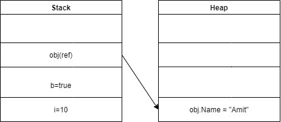

# .NET Fundamentals

## Compilation and runtime

### What is Intermediate Language (IL) code?

<!-- level: intermediate -->

IL is also called MSIL (Microsoft IL) or CIL (Common IL).

- IL code is partially compiled code
- At run time, IL code is compiled to machine-specific code using the environment's properties (CPU, OS, machine configuration, etc.)

You can view the IL code of a DLL or EXE with the **ILDASM** tool.

### What is JIT (Just-In-Time compiler)?

<!-- level: beginner -->

The JIT compiler compiles IL code into machine (native) code at run time.

### What are the different types of JIT?

<!-- level: intermediate -->

- **Normal JIT (default)** – compiles only the methods called at run time and caches them. Uses more memory; suited to ASP.NET and Windows applications.
- **Econo JIT** – compiles only the methods called at run time, without caching. Uses less memory; suited to mobile devices and console applications.
- **Pre-JIT** – compiles the complete source code into native code in a single cycle, at deployment time (e.g. with NGen).

### What is the CLR (Common Language Runtime)?

<!-- level: beginner -->

- Invokes the JIT to compile IL into machine (native) code
- Cleans up unused objects using the garbage collector (GC)

### What is the difference between managed and unmanaged code?

<!-- level: beginner -->

- **Managed code** – runs under the control of the CLR
- **Unmanaged code** – runs outside the CLR (e.g. C, C++ or COM components)

### What is the CTS (Common Type System)?

<!-- level: intermediate -->

The CTS ensures that data types defined in two different languages compile to a common data type. For example, both of these compile to `System.Int32`:

```vbnet
Dim i As Integer
```

```csharp
int i;
```

### What is the CLS (Common Language Specification)?

<!-- level: intermediate -->

The CLS is a set of rules and guidelines that a .NET language must follow, so that code written in one language can be used from another.

## Memory management

### What is the difference between stack and heap?

<!-- level: beginner -->

- **Stack** memory stores value types such as `int`, `double` and `bool`
- **Heap** memory stores reference types such as `string` and objects

### What is the difference between value types and reference types?

<!-- level: beginner -->

- **Value types** contain the actual data
- **Reference types** contain a pointer (reference), and the pointer points to the actual data

```csharp
int i = 10;
bool b = true;
Customer obj = new Customer();
obj.Name = "Amit";
```



### What is the difference between boxing and unboxing?

<!-- level: beginner -->

- **Boxing** – converting a value type to a reference type
- **Unboxing** – converting a reference type to a value type

Mnemonic: **V**alue → **R**eference = **B**oxing, **R**eference → **V**alue = **U**nboxing.

```csharp
public void Method()
{
    int i = 10;
    object obj = i;    // boxing
    int j = (int)obj;  // unboxing
}
```

Boxing and unboxing reduce performance, because data has to move between stack and heap memory.

### What is the garbage collector?

<!-- level: intermediate -->

The garbage collector is a background process that cleans up unused **managed** resources.

```csharp
for (int a = 0; a < 1000000000; a++)
{
    Cls obj = new Cls();
}
```

You can watch the GC at work with the Visual Studio Diagnostic Tools window or CLR Profiler.

### Can we call the garbage collector explicitly?

<!-- level: intermediate -->

Yes, but it is not recommended.

```csharp
GC.Collect();
```

### How do you dispose of an object?

<!-- level: intermediate -->

Release unmanaged resources as soon as you are done with them, by either:

1. Calling the `Dispose()` method
2. Wrapping the object in a `using` block

### What are the uses of the `using` keyword?

<!-- level: intermediate -->

**Using directives** import namespaces, or create aliases for namespaces or types. They go at the top of the file, before any declarations.

```csharp
using System;
using System.IO;
using Services = Application.Services;
```

**Using statements** can only be used with types that implement `IDisposable`. They are syntactic sugar for a `try`/`finally` block that calls `Dispose()` in the `finally` block.

```csharp
using (Stream input = File.OpenRead(filename))
{
    // ...
}
```

### What is the equivalent code of a `using` statement?

<!-- level: intermediate -->

```csharp
using (MyType obj = new MyType())
{
    // ... do stuff
}
```

is equivalent to:

```csharp
MyType obj = new MyType();
try
{
    // ... do stuff
}
finally
{
    if (obj != null)
    {
        obj.Dispose();
    }
}
```

### What is the difference between `Finalize` and `Dispose`?

<!-- level: advanced -->

Both are used to clean up unmanaged resources.

| | Finalize | Dispose |
| --- | --- | --- |
| Syntax | Written as a class destructor | Implemented as a `Dispose()` method |
| Execution | Called non-deterministically (automatically) by the GC | Must be called explicitly to release resources |

**Finalize** is called by the garbage collector:

```csharp
public class Demo
{
    ~Demo()
    {
        Console.WriteLine("Finalize called");
    }
}
```

**Dispose** – resources such as window handles, database connections, network connections and files cannot be collected by the garbage collector. To release them explicitly, implement `IDisposable`:

```csharp
public class Demo : IDisposable
{
    private bool disposed = false;

    public void Dispose()
    {
        Dispose(true);
        GC.SuppressFinalize(this);
    }

    protected virtual void Dispose(bool disposing)
    {
        if (!disposed)
        {
            if (disposing)
            {
                // clean up managed objects
            }
            // clean up unmanaged objects
            disposed = true;
        }
    }
}
```

## Types and collections

### What are casting, implicit casting and explicit casting?

<!-- level: beginner -->

Casting converts one data type to another.

- **Implicit casting** – from a smaller to a larger data type (no data loss)
- **Explicit casting** – from a larger to a smaller data type (possible data loss)

```csharp
int i1 = 10;
double d1 = i1;      // implicit casting

double d2 = 500.2;
int y = (int)d2;     // explicit casting - data loss
```

### What is the difference between `Array` and `ArrayList`?

<!-- level: beginner -->

| | Array | ArrayList |
| --- | --- | --- |
| Fixed length | Yes | No |
| Strongly typed | Yes | No |
| Performance | Better | Slower because of boxing/unboxing |

```csharp
int[] arr = { 1, 2, 3 };

ArrayList arrList = new ArrayList();
arrList.Add(1);
arrList.Add(2);
arrList.Add("three");
```

### What is a generic collection?

<!-- level: beginner -->

A generic collection is strongly typed **and** flexible in size. It performs better than `ArrayList` because there is no boxing/unboxing.

```csharp
List<int> list = new List<int>();
list.Add(1);
list.Add(2);
```

## Methods and parameters

### What is the `out` keyword?

<!-- level: beginner -->

Use `out` when you want a method to return multiple values.

```csharp
static void Main()
{
    Calculate(10, 5, out int add, out int sub);
}

static void Calculate(int n1, int n2, out int add, out int sub)
{
    add = n1 + n2;
    sub = n1 - n2;
}
```

### What is the difference between `ref` and `out`?

<!-- level: beginner -->

- With `ref`, the variable **must be initialised** before it is passed
- With `out`, the method **must assign** the value before it returns

`ref`:

```csharp
static void MethodFunction(ref int i)
{
    i = i + 44;
}

static void Main()
{
    int val = 10; // must be initialised
    MethodFunction(ref val);
    Console.WriteLine(val); // 54
}
```

`out`:

```csharp
static void MethodFunction(out int i)
{
    i = 44; // must be assigned
}

static void Main()
{
    int val;
    MethodFunction(out val);
    Console.WriteLine(val); // 44
}
```

## Exception handling

### How do you handle exceptions in C#?

<!-- level: beginner -->

```csharp
try
{
    int z = 1 / 0;
}
catch (Exception ex)
{
    Console.WriteLine("Exception");
}
finally
{
    Console.WriteLine("Clean up code");
}
```

### What is `finally`?

<!-- level: beginner -->

The `finally` block always executes, whether or not the code throws an exception.

## Threading

### What are threads (multithreading)?

<!-- level: intermediate -->

Threads let code run in parallel.

```csharp
Thread t1 = new Thread(Method1);
t1.Start();

Thread t2 = new Thread(Method2);
t2.Start();
```

### How are threads different from the TPL (Task Parallel Library)?

<!-- level: intermediate -->

```csharp
Task t1 = new Task(Method1);
t1.Start();

Task t2 = new Task(Method2);
t2.Start();
```

The TPL works at a higher level than threads: tasks run on the thread pool, and the TPL manages scheduling across CPU cores for you.

### What is the difference between a Task and a Thread?

<!-- level: intermediate -->

Tasks provide:

- Parallel processing that uses all CPU cores efficiently
- Return values (`Task<T>`), results, continuations and cancellation
- Support for `async` / `await`

## Delegates and events

### What are delegates and how are they used?

<!-- level: intermediate -->

Delegates are type-safe function pointers, used for callbacks between async and parallel executions.

Example: if two processes run in parallel and one needs to send data to the other, a delegate is helpful.

### What are multicast delegates?

<!-- level: intermediate -->

A multicast delegate calls multiple methods with a single invocation.

Example: broadcasting an error message via email, file log, SMS, event log, etc.

```csharp
class Example
{
    public delegate void MyDelegate();

    private void Subscriber1()
    {
        Console.WriteLine("Subscriber 1");
    }

    private void Subscriber2()
    {
        Console.WriteLine("Subscriber 2");
    }

    void Button_Click()
    {
        MyDelegate myDelegate = null;
        myDelegate += this.Subscriber1;
        myDelegate += this.Subscriber2;
        myDelegate.Invoke();
    }
}
```

### What is an anonymous method?

<!-- level: intermediate -->

- Used when the delegate is needed only inside the same function
- Reduces the overhead of instantiating a separate method for the delegate

```csharp
MyDelegate myDelegate = delegate ()
{
    Console.WriteLine("Anonymous method");
};
```

### What are events?

<!-- level: intermediate -->

Events use delegates internally. They encapsulate the delegate and make it safe: subscribers can only add (`+=`) or remove (`-=`) handlers, and cannot overwrite or invoke it.

```csharp
void Button_Click()
{
    MyDelegate myDelegate = null;
    myDelegate += this.Subscriber1;
    myDelegate += this.Subscriber2;
    myDelegate = null; // a plain delegate can be wiped out like this; an event cannot
}
```

### What is the difference between delegates and events?

<!-- level: intermediate -->

- Events use delegates
- Delegates are for callbacks and are not encapsulated
- Events follow the publisher–subscriber model and are encapsulated
