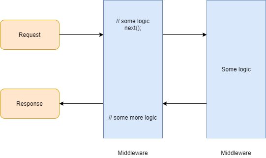

# ASP.NET Core

## Basics

### What is ASP.NET Core MVC?

It is an open-source, **cross-platform** web development framework from Microsoft for building web applications.

### What is the difference between Web Forms, MVC 5 and ASP.NET Core?

| | Web Forms | MVC 5 | ASP.NET Core |
| --- | --- | --- | --- |
| Cross-platform | No | No | Yes |
| Performance | Slow | Better | Best (framework split into smaller packages) |
| Simplicity | Complicated | Medium | Very simplified |
| Cloud ready | No | Partly | Yes |
| Self-hosting | No | No | Yes (Kestrel) |

### What is MVC architecture?

MVC (Model–View–Controller) is an architecture pattern that separates an application into three parts:

- **Model** – data and business logic
- **View** – the UI
- **Controller** – handles the request, works with the model and selects the view

### What is Razor?

Razor is a view engine that lets you mix HTML and C# code. Server-side code in a `.cshtml` page starts with `@`.

### Why do we have the wwwroot folder?

It stores static content such as HTML, CSS, JavaScript and image files.

## Configuration

### What is appsettings.json?

`appsettings.json` stores configuration information, such as connection strings and application settings.

### How do you read configuration from appsettings.json?

Through `IConfiguration`, injected into the class that needs it:

```csharp
public class HomeController : Controller
{
    private readonly IConfiguration _configuration;

    public HomeController(IConfiguration configuration)
    {
        _configuration = configuration;
    }

    public IActionResult Index()
    {
        string connection = _configuration.GetConnectionString("DefaultConnection");
        string title = _configuration["AppSettings:Title"];
        return View();
    }
}
```

### What is the difference between `ConfigureServices` and `Configure` in Startup.cs?

- `ConfigureServices` – configures the dependency injection container (registers services)
- `Configure` – configures the middleware pipeline

> **Note:** From .NET 6, both are done in `Program.cs` – services through `builder.Services`, and middleware on the `app` object.

## Dependency injection

### What is dependency injection?

DI is the practice of providing dependent objects from outside a class, rather than creating them inside it.

### Why do we need DI?

- High-level modules should not depend on low-level modules
- Decoupling – a change in one place is reflected everywhere the dependency is used
- Easier unit testing, because dependencies can be mocked

### How do we implement DI?

Register the service in `ConfigureServices` (or `builder.Services` in .NET 6+), then accept it in the constructor:

```csharp
public void ConfigureServices(IServiceCollection services)
{
    services.AddScoped(typeof(IRequestDeal<>), typeof(DealDomain<>));
}
```

### What is the difference between Scoped, Transient and Singleton?

- **`AddScoped`** – the same instance within the scope of a given HTTP request, but a new instance across different HTTP requests
- **`AddTransient`** – a new instance every time one is requested, whether within the same HTTP request or across different ones
- **`AddSingleton`** – a single instance is created when the service is first requested, and used by all HTTP requests for the lifetime of the application

| | Within the same HTTP request | Across different HTTP requests |
| --- | --- | --- |
| Scoped | Same instance | New instance |
| Transient | New instance | New instance |
| Singleton | Same instance | Same instance |

## Middleware

### What is middleware used for?

Middleware components are pieces of code added to the application's pipeline. Each one handles the request and response, and can run logic before and after the next component – for example, pre-processing before a controller executes.



### How do you implement custom middleware?

1. Create a middleware class (from the Visual Studio template, or by hand)
2. Write your logic inside the `Invoke` / `InvokeAsync` method
3. Register it in the `Configure` method of Startup.cs

```csharp
public class CustomMiddleware
{
    private readonly RequestDelegate _next;

    public CustomMiddleware(RequestDelegate next)
    {
        _next = next;
    }

    public async Task InvokeAsync(HttpContext context)
    {
        // logic before the next middleware
        await _next(context);
        // logic after the next middleware
    }
}
```

```csharp
app.UseMiddleware<CustomMiddleware>();
```

## Hosting

### What is Kestrel?

Kestrel is an open-source, cross-platform web server built into ASP.NET Core.

### Why Kestrel?

Kestrel is cross-platform and lightweight, so ASP.NET Core applications can be self-hosted on Windows, Linux and macOS without IIS.

## State management

### What are cookies?

Cookies are small text files stored in the end user's browser by a website.

### What is session management?

Session management techniques maintain state between HTTP requests, because HTTP itself is stateless.

### What are the different ways of doing session management?

- Session
- Cookies
- Query strings
- ViewData
- ViewBag
- TempData
