# Software Architect

## The role

### What does a software architect do?

<!-- level: beginner -->

A software architect makes the **structural decisions that are expensive to change later**, and makes sure the system meets both the business goals and the quality goals (performance, security, availability, cost).

Day to day, that means:

- **Understanding the problem** – business goals, constraints, users, budget and deadlines
- **Choosing the architecture** – style, technologies, integration and data strategy
- **Defining non-functional requirements** – how fast, how available, how secure, how much it may cost
- **Documenting and communicating decisions** – diagrams and Architecture Decision Records (ADRs)
- **Guiding the team** – reviews, standards, mentoring and unblocking
- **Managing risk and technical debt** – spotting problems before they become expensive

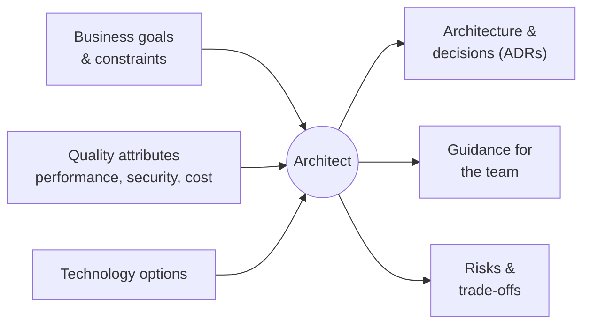

> **Interview tip:** Interviewers want to hear about **trade-offs**. For every decision you mention, say what you gave up and why it was worth it.

### What is the difference between a software architect, a solution architect and a tech lead?

<!-- level: intermediate -->

| Role | Focus | Scope |
| --- | --- | --- |
| **Tech lead** | How the team builds it – code quality, delivery, mentoring | One team or product |
| **Software architect** | How the system is structured – components, patterns, quality attributes | One system or product |
| **Solution architect** | How a business problem is solved end to end – systems, integrations, vendors, cost | Several systems |
| **Enterprise architect** | How the organisation's technology fits together – standards and roadmap | Whole organisation |

In smaller companies one person often plays several of these roles.

### What are non-functional requirements (quality attributes)?

<!-- level: intermediate -->

Functional requirements describe **what** the system does; non-functional requirements describe **how well** it does it. They drive most architecture decisions.

| Quality attribute | Example requirement | Typical architecture answer |
| --- | --- | --- |
| Performance | 95% of API calls under 200 ms | Caching, indexing, async processing |
| Scalability | Handle 10× traffic at peak | Stateless services, horizontal scaling |
| Availability | 99.9% uptime | Redundancy, health checks, failover |
| Security | Only authorised users see customer data | OAuth 2.0 / OpenID Connect, encryption, least privilege |
| Maintainability | New developer productive in a week | Modular design, clean code, documentation |
| Observability | Find the cause of an error in minutes | Centralised logging, tracing, metrics |
| Cost | Run within a fixed cloud budget | Right-sizing, autoscaling, serverless |

> **Common mistake:** Accepting vague requirements such as "the system must be fast". Turn each one into a measurable target, e.g. "p95 latency under 300 ms at 500 requests per second".

### How do you document an architecture?

<!-- level: intermediate -->

Two lightweight tools cover most needs:

**1. The C4 model** – four levels of diagrams, each zooming into the previous one:

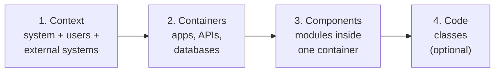

**2. Architecture Decision Records (ADRs)** – a short file per important decision, kept in the repository:

```text
ADR-007: Use RabbitMQ for alarm notifications

Status:       Accepted
Context:      Alarms must reach several services in near real time; services are deployed independently.
Decision:     Publish alarm events to RabbitMQ; each service subscribes to the events it needs.
Consequences: + Services are decoupled and can scale separately
              - We must handle duplicate messages and monitor the broker
```

> **Interview tip:** ADRs show you think about trade-offs. Mention that they record **why** a decision was made, which is exactly what new team members ask months later.

## Architecture styles

### What is the difference between layered, Clean and Hexagonal architecture?

<!-- level: intermediate -->

All three separate business logic from technical details; they differ in **which way dependencies point**.

- **Layered (N-tier)** – UI → Business → Data. Simple, but the business layer depends on the data layer, so the database leaks into business code.
- **Clean / Onion** – the **domain is at the centre** and has no dependencies. Outer layers (UI, database, external services) depend inwards, through interfaces defined by the inner layers.
- **Hexagonal (Ports & Adapters)** – the same idea described differently: the core exposes **ports** (interfaces), and **adapters** plug in for HTTP, databases, queues, etc.

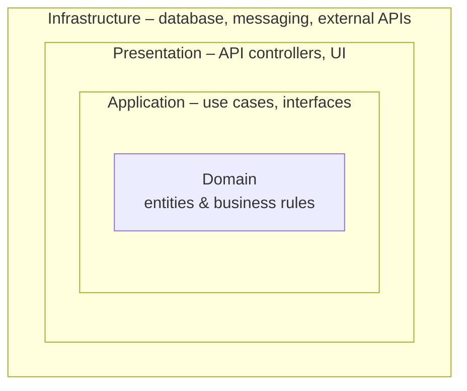

Dependencies always point **inwards**: the domain knows nothing about ASP.NET Core or SQL Server, so it is easy to test and the infrastructure can be swapped.

### When would you choose a monolith, a modular monolith or microservices?

<!-- level: intermediate -->

| | Monolith | Modular monolith | Microservices |
| --- | --- | --- | --- |
| Deployment | One unit | One unit | Many independent units |
| Team size | Small | Small to medium | Many teams |
| Complexity | Low | Low to medium | High (network, data, operations) |
| Scaling | Whole app | Whole app | Per service |
| Best for | MVPs, simple domains | Most new business systems | Large domains, independent teams, very different scaling needs |

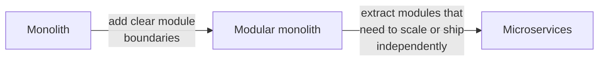

> **Interview tip:** A strong answer is "start with a modular monolith, and extract microservices only where there is a clear reason – team autonomy, independent scaling or independent release cycles." It shows you don't choose microservices by default.

### What is event-driven architecture?

<!-- level: intermediate -->

Services communicate by **publishing events** ("something happened") to a broker, instead of calling each other directly. Other services subscribe to the events they care about.

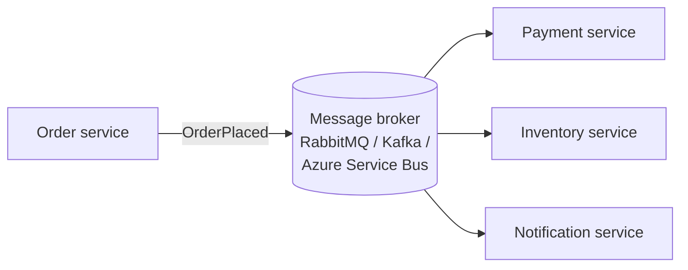

| Advantages | Challenges |
| --- | --- |
| Loose coupling – the publisher doesn't know the subscribers | Eventual consistency – data is not updated everywhere at once |
| Services scale and fail independently | Duplicate and out-of-order messages must be handled |
| Easy to add new subscribers | Harder to trace a request end to end |

### What is CQRS and when should you use it?

<!-- level: advanced -->

**CQRS (Command Query Responsibility Segregation)** separates the model that **changes** data (commands) from the model that **reads** data (queries).

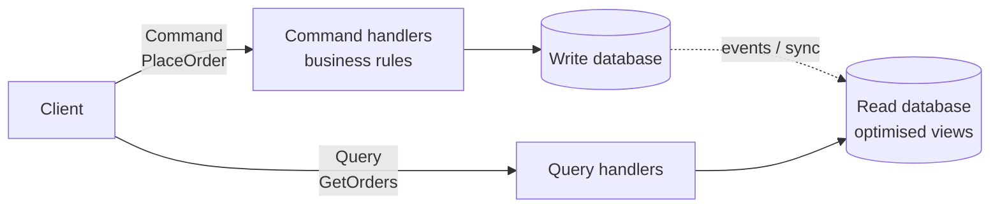

**Use it when** reads and writes have very different shapes or loads – for example, complex validation on writes but dashboards and searches on reads. In .NET it is often implemented with **MediatR**.

**Avoid it** for simple CRUD applications: it adds complexity and, with separate databases, eventual consistency.

## Scale and reliability

### What is the difference between vertical and horizontal scaling?

<!-- level: beginner -->

- **Vertical scaling (scale up)** – give one server more CPU or memory. Simple, but limited and usually needs downtime.
- **Horizontal scaling (scale out)** – add more servers behind a load balancer. Almost unlimited and fault-tolerant, but the application must be **stateless** (sessions and files stored outside the server).

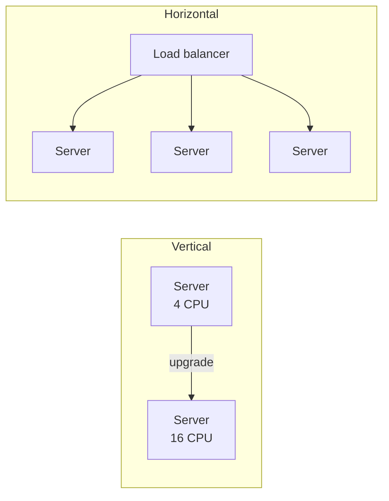

### What caching strategies do you know?

<!-- level: intermediate -->

The most common is **cache-aside**: the application checks the cache first and loads from the database only on a miss.

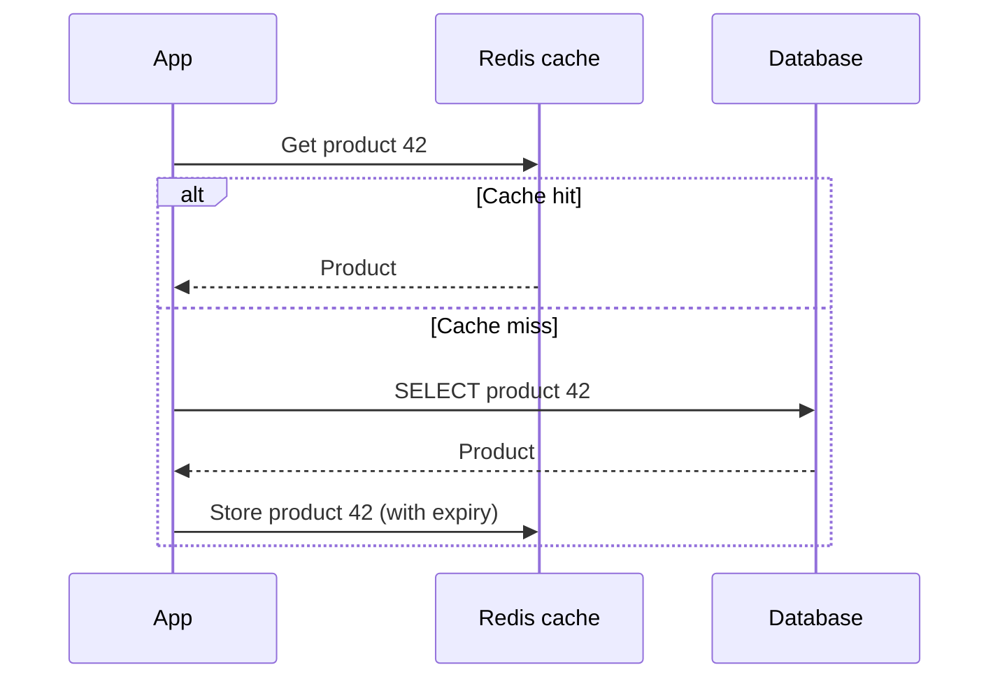

| Strategy | How it works | Use when |
| --- | --- | --- |
| Cache-aside | App reads cache, falls back to DB, then fills the cache | Read-heavy data – the default choice |
| Write-through | App writes to cache and DB together | Data is read right after it is written |
| Write-behind | App writes to cache; DB is updated later | Very high write load, some risk is acceptable |
| Read-through | Cache loads from DB itself on a miss | The cache library supports it |

> **Common mistake:** Forgetting **invalidation**. Always set an expiry (TTL) and remove or update cache entries when the data changes.

### What is the CAP theorem?

<!-- level: advanced -->

In a distributed system, when a **network partition** happens, you must choose between:

- **Consistency (C)** – every read returns the latest write, or an error
- **Availability (A)** – every request gets a response, even if it may be stale

Partition tolerance (P) is not optional in a distributed system, so the real choice is **CP or AP** during a failure:

| Choice | Behaviour during a partition | Examples |
| --- | --- | --- |
| CP | Rejects some requests to stay consistent | Banking balances, inventory reservations |
| AP | Keeps answering, may return stale data | Product catalogue, social feeds, shopping carts |

> **Interview tip:** Mention **PACELC** for extra credit: even without a partition, there is a trade-off between **latency** and **consistency**.

### How do you design a system for high availability?

<!-- level: advanced -->

Remove every **single point of failure** and make failures fast to detect and recover from:

- Run **multiple instances** of every service across **availability zones**
- Put a **load balancer** with **health checks** in front
- **Replicate** the database, with automatic failover
- Use **retries with back-off, timeouts and circuit breakers** for calls between services
- Keep services **stateless**; store state in the database or a distributed cache
- **Monitor and alert** – you can't fix what you can't see

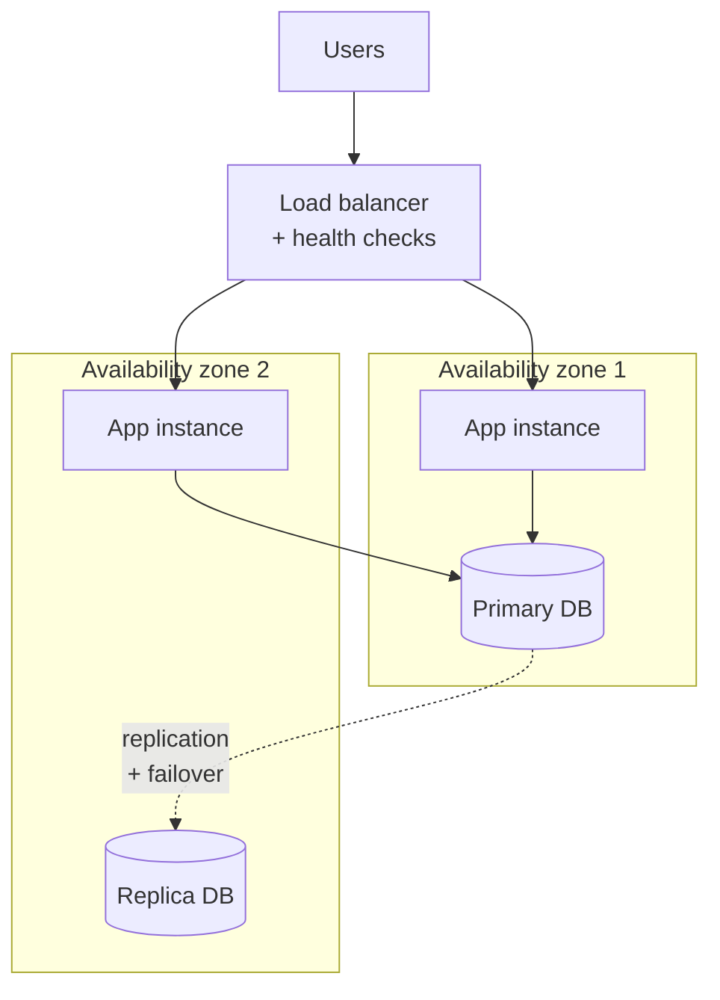

| Availability | Downtime per year |
| --- | --- |
| 99% | ~3.7 days |
| 99.9% | ~8.8 hours |
| 99.99% | ~53 minutes |

### How do you approach a system design question in an interview?

<!-- level: advanced -->

Use a fixed structure so you don't jump straight to technologies:

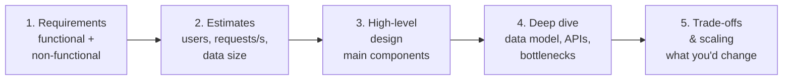

1. **Clarify requirements** – ask questions; agree what is in and out of scope
2. **Estimate the scale** – rough numbers decide whether you need caching, sharding or queues
3. **Draw the high-level design** – clients, API, services, databases, caches, queues
4. **Deep dive** into the hardest parts – data model, APIs, consistency, hot spots
5. **Discuss trade-offs** – failure handling, scaling, cost and what you'd do with more time

## Experience questions

> **Interview tip:** Answer experience questions with **STAR** – **S**ituation, **T**ask, **A**ction, **R**esult. Keep it to 2–3 minutes and be ready to go deeper on any decision. The answers below are personal examples – replace them with your own projects.

### Walk us through a recent project where you were the architect. What challenges did you face?

<!-- level: advanced -->

**Situation:** At Honeywell, I was the architect of a **Gate Management System** that controls vehicle entry to a site. It integrates third-party devices: **UVSS** (Under Vehicle Surveillance System), **LPR** (License Plate Recognition) and **X-ray** scanners.

**Task:** Process data from all devices in real time, give gate operators a live view, and make it easy to add new devices later.

**Action:** I designed an API-driven, event-based **microservices** architecture with **ASP.NET Core**, **gRPC** and **SQL Server**, and a **React** front end for operators.

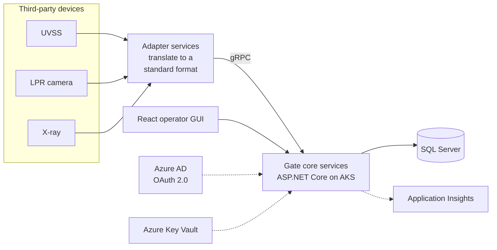

| Challenge | What I did |
| --- | --- |
| Real-time processing from several devices | **gRPC** for low-latency, high-throughput communication between services |
| Peak-hour load | **Docker** containers on **AKS**, scaled with demand |
| Legacy third-party devices | **Adapter services** that translate each device's data into one standard format |
| Sensitive vehicle data | **OAuth 2.0** with **Azure AD**; secrets such as API keys in **Azure Key Vault** |
| Diagnosing issues | **Azure Application Insights** for monitoring and diagnostics |

**Result:** The system was deployed successfully. It processes vehicle data in real time, scales during peak hours, and new sensors or devices can be added by writing a new adapter.

---

**Alternative answer – HBOC OS portal**

**Situation:** At Honeywell, I owned the end-to-end architecture of the **HBOC OS** (Honeywell Building Operations Center) portal, which the HBOC team uses for alarm management, remote support and cloud hosting of building automation systems such as **EBI** and **Niagara**.

**Action:** **React** front end, **GraphQL** for flexible data fetching, **Web API** services and **PostgreSQL**, with an **event-driven** design using **RabbitMQ**.

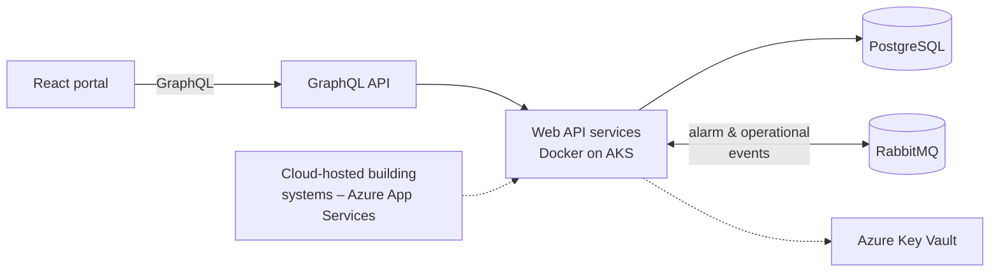

| Challenge | What I did |
| --- | --- |
| Complex queries across buildings and alarms | **GraphQL**, so the front end fetches only the data it needs – no over-fetching |
| Real-time alarms and notifications | **RabbitMQ** as the message broker for event-driven processing |
| Many buildings and remote sites | **Docker** on **AKS** to scale with load |
| Secure cloud hosting for customers | **Azure App Services** with credentials and connection strings in **Azure Key Vault** |
| Consistent alarm state | Kept data in **PostgreSQL** and **RabbitMQ** in sync, so the portal always shows the correct state |

**Result:** An efficient, scalable, real-time platform for managing alarms and remote support, with timely updates for customers.

> **Interview tip:** Expect the follow-up "How did you keep the database and RabbitMQ consistent?" A good answer mentions the **Outbox pattern** – save the event in the same database transaction as the data, then publish it from the outbox.

### Tell us about a challenging situation at work and how you overcame it.

<!-- level: advanced -->

**Situation:** At Société Générale, the **CDM-Historical** system provides KPIs for monitoring electronic trading. As historical data grew, the system became slow – and traders needed the KPIs to make decisions.

**Task:** Make the system fast again, and make sure it would keep up with future data growth.

**Action:**

| Problem | What I did |
| --- | --- |
| Slow SQL queries on large tables | Analysed the queries and schema, added the right **indexes**, rewrote inefficient queries and **partitioned** large tables |
| The same KPIs queried repeatedly | **Redis** caching for frequently accessed data |
| Heavy calculations blocking the UI | Moved data retrieval and heavy computations to **asynchronous background processing** |
| Architecture couldn't scale | Refactored for **horizontal scaling** with **Docker** on **Kubernetes**, adding containers during peak trading hours |

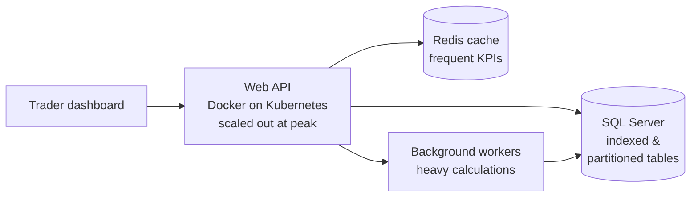

**Result:** Data retrieval response time dropped by **over 60%**, the system scaled with growing data volumes, and traders got their insights without delay.

### How do you approach client interactions during the software development cycle?

<!-- level: advanced -->

I involve the client at every stage, so there are no surprises at the end.

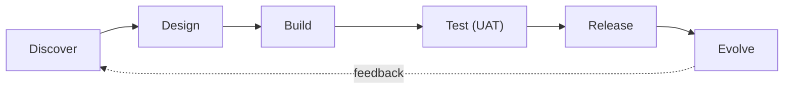

| Phase | What I do with the client |
| --- | --- |
| **Discover** | Understand business goals and pain points; ask clarifying questions; document requirements as user stories; validate with wireframes or prototypes |
| **Design** | Present 2–3 options with trade-offs (cost, performance, scalability, flexibility); explain decisions such as microservices vs monolith; build a proof of concept where useful |
| **Build** | Regular check-ins through Scrum; sprint demos of working features; manage expectations on scope and timelines |
| **Test** | Coordinate user acceptance testing (UAT) with clear guidelines; act on feedback quickly |
| **Release** | Plan the deployment, data migrations and downtime together; provide documentation and training |
| **Evolve** | Support after launch; gather feedback; plan improvements as the business grows |

The common thread is **transparency** – sharing risks, progress and problems early builds trust.

### What challenges did you face moving from a monolith to microservices?

<!-- level: advanced -->

I migrated **incrementally** using the **Strangler Fig** pattern: new and extracted features go to new services, an API gateway routes traffic, and the monolith shrinks over time.

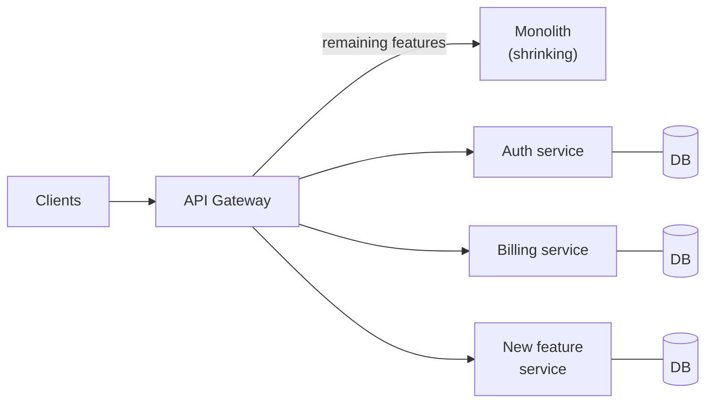

| Challenge | Solution |
| --- | --- |
| **Where to split** | **Domain-Driven Design** – one service per bounded context; start with a few critical services (e.g. authentication, billing); extract more when building new features |
| **Shared database** | **Database per service** (SQL or NoSQL as needed); **events** via RabbitMQ or Kafka to share changes; the **Saga pattern** for multi-service transactions |
| **Network calls** | **REST or gRPC** for synchronous calls, **message queues** for asynchronous work; **circuit breakers** with **Polly** to stop cascading failures |
| **Finding services and routing** | Service discovery with **Consul** or **Azure Service Fabric**; an **API Gateway** (**Kong**) for routing, authentication and rate limiting; **Kubernetes Ingress** and **autoscaling** |
| **Debugging across services** | Centralised logging with **Application Insights** or **ELK**; distributed tracing with **OpenTelemetry** or **Jaeger**; Kubernetes **health probes** |
| **Security** | **OAuth 2.0 and JWT** validated at the gateway; **mTLS** between services; secrets in **Azure Key Vault**; **RBAC** per service |

**Result:** More scalable and maintainable systems, faster and independent deployments through **CI/CD**, and services that scale individually based on demand.

### How do you manage technical debt while architecting new solutions?

<!-- level: advanced -->

I treat technical debt like financial debt: some is acceptable if it is **visible, deliberate and paid back**.

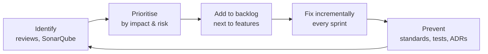

| Step | How |
| --- | --- |
| **Identify** | Code reviews, **SonarQube** metrics, test coverage, outdated libraries, temporary workarounds |
| **Prioritise** | High / medium / low by impact on security, performance and future change; high-impact items first |
| **Make it visible** | Debt items go into the **product backlog** alongside features; explain the cost of delay to product owners in business terms |
| **Fix incrementally** | Reserve part of every sprint for refactoring; small, safe changes instead of big rewrites |
| **Prevent** | Modular design, **SOLID** and **Clean Architecture**, **TDD** and automated tests in **CI/CD**, architecture reviews, living documentation (Swagger, wiki, ADRs) |
| **Avoid over-engineering** | Build for the MVP and real requirements; optimise when real usage shows a bottleneck |

**Result:** Debt stays under control without slowing down delivery – the codebase remains easy to maintain, scale and extend.
