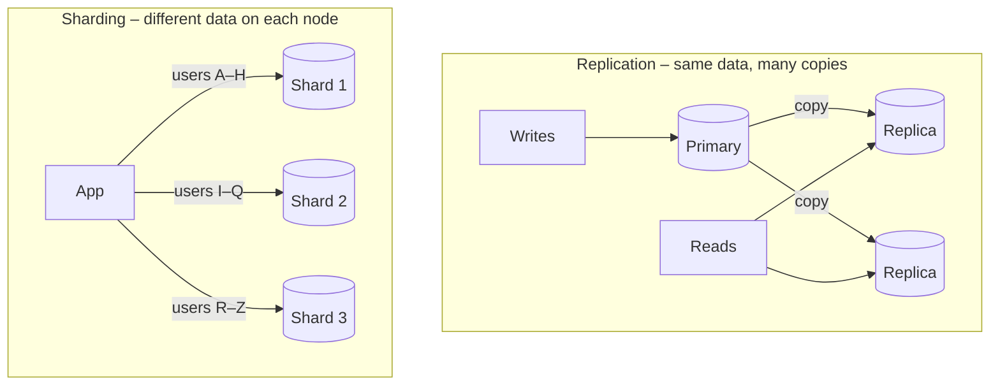
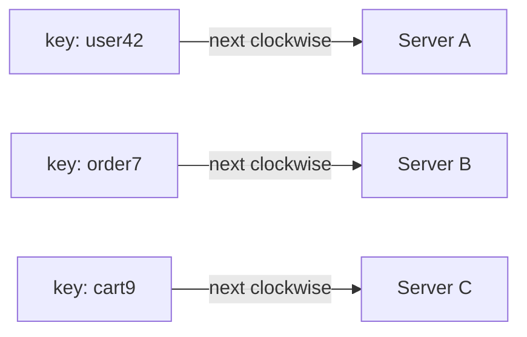
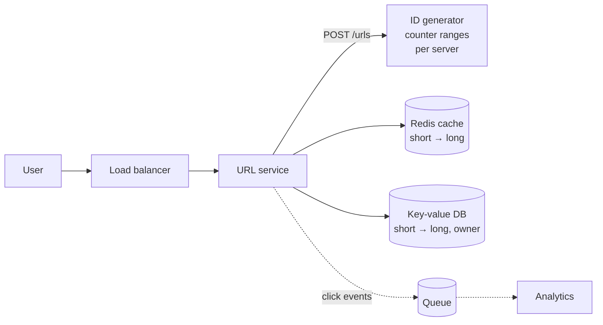
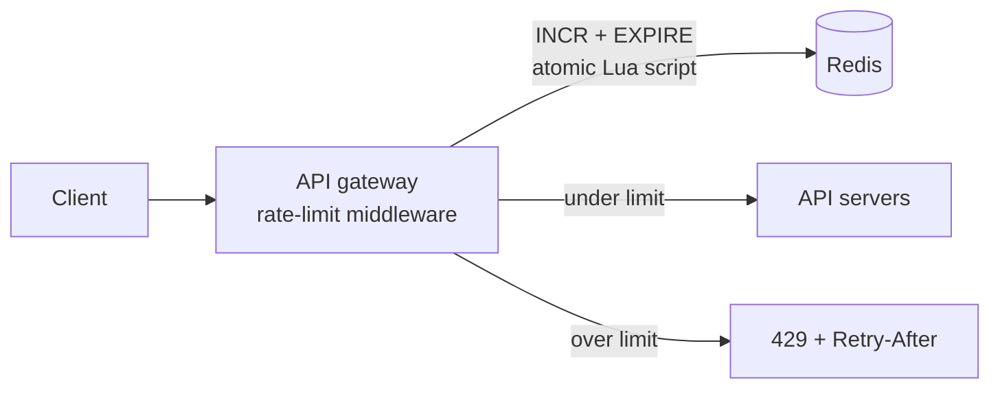
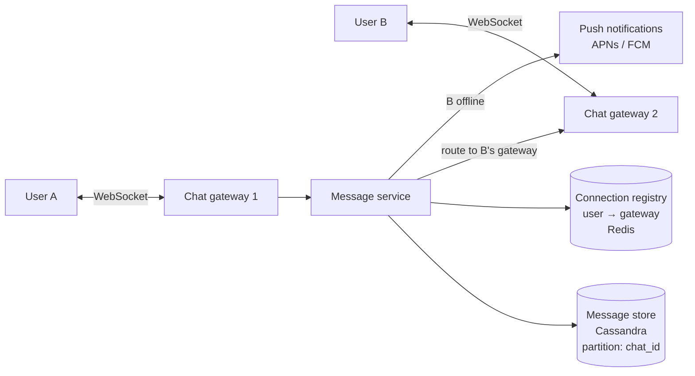
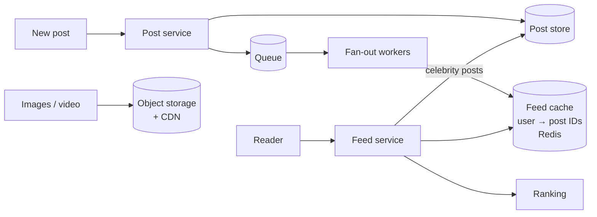
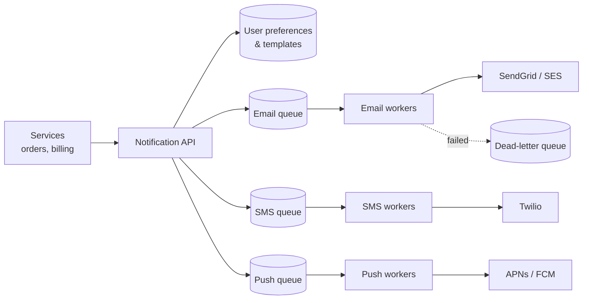
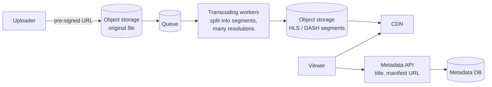
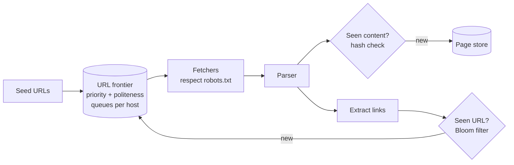

# System Design

> **Note:** The interview framework, scaling, caching strategies, the CAP theorem and high availability are covered on the [Software Architect](SoftwareArchitect.md) page. This page covers the other building blocks and the classic design questions.

## Estimation

### How do you do back-of-the-envelope estimates?

<!-- level: intermediate -->

Rough numbers tell you whether one database is enough or whether you need caching, sharding and queues. Round aggressively and say your assumptions out loud.

```text
Numbers worth remembering
1 day           ≈ 100,000 seconds (86,400)
1M requests/day ≈ 12 requests/second
Read from memory ≈ 100 ns     Read 1 MB from SSD ≈ 1 ms
Same-region round trip ≈ 1 ms Cross-continent round trip ≈ 100 ms

Example: 100M daily users, each makes 10 reads and 1 write per day
Reads  = 1B/day  ≈ 12,000/s   (peak ×2–3 ≈ 30,000/s)
Writes = 100M/day ≈ 1,200/s
Storage = 100M writes × 1 KB = 100 GB/day ≈ 36 TB/year
```

> **Interview tip:** Don't spend more than a few minutes on estimates. The goal is to spot the bottleneck – for example "reads outnumber writes 10:1, so caching and read replicas matter most".

## Building blocks

### What does a load balancer do, and what algorithms does it use?

<!-- level: beginner -->

A load balancer spreads requests across several servers, removes unhealthy servers using health checks, and lets you add servers without clients noticing.

| Algorithm | How it works | Good for |
| --- | --- | --- |
| **Round robin** | Each server in turn | Servers of equal size, similar requests |
| **Weighted round robin** | Bigger servers get more requests | Mixed server sizes |
| **Least connections** | Server with the fewest open connections | Long or uneven requests |
| **IP / consistent hash** | Same client or key always goes to the same server | Caches, sticky sessions |

**Layer 4** load balancers route on IP and port (fast, protocol-agnostic). **Layer 7** load balancers understand HTTP and can route by path, header or cookie, and terminate TLS.

### What is the difference between replication and sharding?

<!-- level: intermediate -->



| | Replication | Sharding (partitioning) |
| --- | --- | --- |
| **Solves** | Read scaling and availability | Write scaling and data size |
| **Each node holds** | All the data | Part of the data |
| **Main problem** | Replication lag – a replica may return stale data | Choosing the shard key; queries and transactions across shards |

Choose a shard key that spreads load evenly and keeps related data together (for example `user_id`). A bad key creates **hot shards** – for example sharding by country when most users are in one country.

### What is consistent hashing?

<!-- level: advanced -->

With simple hashing (`hash(key) % N`), adding or removing one server changes the server for almost every key, so the whole cache is invalidated.

Consistent hashing places both servers and keys on a ring. Each key belongs to the next server clockwise. When a server is added or removed, only the keys next to it move – roughly `1/N` of them.



**Virtual nodes** – each physical server appears many times on the ring, which spreads keys more evenly and shares the load of a failed server across all the others. Used in DynamoDB, Cassandra and many distributed caches.

### SQL or NoSQL – how do you choose?

<!-- level: intermediate -->

| Choose | When |
| --- | --- |
| **Relational (SQL Server, PostgreSQL)** | Structured data with relationships, transactions across rows, complex queries – orders, payments, inventory |
| **Key-value (Redis, DynamoDB)** | Lookups by key at very high speed – sessions, caches, carts |
| **Document (MongoDB, Cosmos DB)** | Flexible JSON documents read as a whole – product catalogues, user profiles |
| **Wide-column (Cassandra)** | Huge write volume, queries known in advance – messages, time series, events |
| **Search (Elasticsearch)** | Full-text search, filtering and aggregations |
| **Object storage (S3, Blob)** | Files, images, videos, backups |

> **Interview tip:** "Start with a relational database unless there is a clear reason not to" is a safe and respected default. Then name the specific access pattern that would push you to something else.

### What is a message queue and when would you use one?

<!-- level: intermediate -->

A message queue (RabbitMQ, SQS, Azure Service Bus, Kafka) lets a producer hand off work and move on, while consumers process it at their own pace.

Use one to:

- **Decouple services** – the producer doesn't need the consumer to be up
- **Absorb spikes** – the queue grows during peaks instead of servers falling over
- **Do slow work asynchronously** – sending emails, resizing images, generating reports
- **Fan out events** – one "order placed" event feeds billing, shipping and analytics

Things to design for: **at-least-once delivery** (so consumers must be idempotent), **dead-letter queues** for messages that keep failing, and **ordering** (only guaranteed within a partition or session).

### What is a CDN?

<!-- level: beginner -->

A Content Delivery Network keeps copies of static content (images, videos, JavaScript, CSS) on servers close to users around the world. Users download from the nearest edge server, which cuts latency and takes load off your origin servers.

Use cache headers (`Cache-Control`) and versioned file names (`app.3f9c.js`) so you can cache files for a long time and still release new versions instantly.

### What is the difference between polling, long polling, WebSockets and server-sent events?

<!-- level: intermediate -->

| Technique | How it works | Use for |
| --- | --- | --- |
| **Short polling** | Client asks every few seconds | Simple dashboards; wasteful at scale |
| **Long polling** | Server holds the request open until there is data | Fallback when WebSockets aren't available |
| **Server-sent events (SSE)** | One long HTTP response; server pushes, client only listens | Live feeds, notifications, streaming LLM output |
| **WebSockets** | Persistent two-way connection | Chat, multiplayer games, collaborative editing |

## Classic design questions

### Design a URL shortener (like bit.ly)

<!-- level: intermediate -->

**Requirements:** Create a short link for a long URL; redirect quickly; 100M new links per month; reads outnumber writes 100:1; links don't expire by default.



- **Short code** – 7 characters of base62 (`a–z A–Z 0–9`) gives 62⁷ ≈ 3.5 trillion codes
- **Generating codes** – each server takes a range of IDs from a counter service (e.g. 1–1,000,000) and base62-encodes them: no collisions, no database check. Hashing the long URL also works but needs collision handling
- **Redirect** – `301` (permanent, browsers cache it, fewer hits) vs `302` (temporary, every click reaches you, better for analytics)
- **Read path** – cache popular codes in Redis; the database is a simple key-value lookup
- **Analytics** – publish click events to a queue rather than writing synchronously on every redirect
- **Abuse** – rate limit link creation; check URLs against malware lists

### Design a rate limiter

<!-- level: intermediate -->

**Requirements:** Limit each API key to N requests per minute across many API servers; add very little latency; return `429 Too Many Requests` with a `Retry-After` header.

| Algorithm | How it works | Trade-off |
| --- | --- | --- |
| **Token bucket** | Bucket refills at a fixed rate; each request takes a token | Allows short bursts; most common choice |
| **Leaky bucket** | Requests leave a queue at a fixed rate | Smooth output; bursts wait or are dropped |
| **Fixed window** | Count per calendar minute | Simple; allows 2× burst at window edges |
| **Sliding window log / counter** | Count requests in the last 60 seconds | Accurate; more memory or computation |



- Store counters in a **shared store (Redis)** so all servers see the same count; use an atomic script to avoid race conditions
- Decide whether to **fail open** (allow traffic if Redis is down) or **fail closed** – usually fail open for availability
- Limit at several levels: per user, per IP, per endpoint, and globally

### Design a chat application (like WhatsApp or Slack)

<!-- level: advanced -->

**Requirements:** One-to-one and group chat; messages delivered in real time; offline users get messages later; message history; online/offline status.



- **WebSockets** keep a persistent connection; a registry records which gateway each user is connected to
- **Message flow** – save the message first, then deliver; the client acknowledges, giving *sent → delivered → read* ticks
- **Ordering** – a sequence number per conversation, assigned by the server
- **Storage** – a wide-column store partitioned by `chat_id` and sorted by time suits "load the last 50 messages"
- **Groups** – fan out to each member's gateway; for very large channels, members pull instead of the server pushing to everyone
- **Presence** – heartbeats with a timeout; publish changes only to contacts who are online
- **Security** – end-to-end encryption means the server stores only ciphertext

### Design a news feed (like Twitter/X or Instagram)

<!-- level: advanced -->

The key decision is **when** to build each user's feed:

| Approach | How it works | Problem |
| --- | --- | --- |
| **Fan-out on write (push)** | When someone posts, add the post ID to each follower's feed cache | A celebrity with 50M followers creates 50M writes |
| **Fan-out on read (pull)** | When a user opens the app, fetch recent posts from everyone they follow and merge | Slow for users who follow thousands of accounts |
| **Hybrid** | Push for normal users; pull celebrity posts at read time and merge | More complex, but this is what large systems do |



- Store only **post IDs** in the feed cache; fetch post content in bulk (and from cache)
- Use **cursor-based pagination** (`?after=postId`) rather than page numbers, because the feed changes constantly
- Ranking can start as reverse chronological and later use an ML model

### Design a notification system

<!-- level: intermediate -->

**Requirements:** Send email, SMS and push notifications triggered by other services; respect user preferences; millions per day; no duplicates.



- **A queue per channel** so a slow SMS provider doesn't delay emails
- **Idempotency key** per notification so retries don't send twice
- **Preferences and quiet hours** checked before sending; always allow opt-out
- **Retries with backoff**, then a dead-letter queue; fall back to a second provider
- **Priority** – a password-reset code must not wait behind a marketing campaign
- **Tracking** – store status (queued, sent, delivered, opened) for support and analytics

### Design a video streaming service (like YouTube or Netflix)

<!-- level: advanced -->



- **Upload directly to object storage** with a pre-signed URL, so large files don't pass through your API servers
- **Transcoding** – split the video into chunks and process them in parallel into several resolutions and codecs
- **Adaptive bitrate streaming (HLS/DASH)** – the player switches quality every few seconds based on bandwidth
- **CDN** serves almost all traffic; popular content is pushed to edge locations in advance
- **Metadata** (titles, views, comments) lives in ordinary databases; view counts are aggregated asynchronously

### Design a ride-sharing service (like Uber)

<!-- level: advanced -->

- **Location updates** – drivers send their position every few seconds; store only the latest in memory (Redis), not every point in the main database
- **Finding nearby drivers** – index locations with a **geohash** or quadtree so "drivers within 2 km" is a lookup of nearby cells, not a scan of all drivers
- **Matching** – offer the trip to the best nearby driver; lock the driver so two riders can't be matched to them at once
- **Trip state machine** – requested → accepted → driver arriving → in progress → completed → paid
- **Real-time updates** to the rider via WebSockets
- **Payments** – handled by a separate service with idempotent charges
- **Surge pricing** – computed per geographic cell from the ratio of demand to available drivers

### Design a distributed cache (like Redis Cluster)

<!-- level: advanced -->

- **Partitioning** – consistent hashing (or fixed hash slots) to spread keys across nodes
- **Replication** – each partition has a primary and replicas; promote a replica if the primary fails
- **Eviction** – LRU or LFU when memory is full; TTLs on keys
- **Hot keys** – replicate them to several nodes or add a small local cache in the application
- **Cache stampede** – when a popular key expires, many requests hit the database at once; prevent it with a lock so one request refreshes it, or refresh early with random jitter

### Design a web crawler

<!-- level: advanced -->



- **Politeness** – one queue per host and a delay between requests to the same site; obey `robots.txt`
- **Deduplication** – a Bloom filter for visited URLs; content hashes to spot duplicate pages
- **Prioritisation** – crawl important and frequently changing pages more often
- **Traps** – limit URL length and depth to avoid infinite calendars and generated links

## Reliability and consistency

### How do you make an API idempotent?

<!-- level: intermediate -->

Networks fail, clients retry, and messages get delivered twice. An idempotent operation gives the same result no matter how many times it runs.

1. The client sends a unique **`Idempotency-Key`** header (e.g. a GUID) with each logical request
2. The server stores the key with the result in the same transaction as the change
3. A retry with the same key returns the stored result instead of repeating the change

```text
POST /payments
Idempotency-Key: 6f1c2a9e-...
→ first call:  charge card, store (key, result), return 201
→ retry:       key found, return the stored 201 – no second charge
```

### How do you generate unique IDs in a distributed system?

<!-- level: advanced -->

| Option | Pros | Cons |
| --- | --- | --- |
| **Database auto-increment** | Simple, ordered | Single point of failure; hard across shards |
| **UUID v4** | No coordination | 128 bits; random order hurts index performance |
| **UUID v7 / ULID** | No coordination and time-ordered | Still 128 bits |
| **Snowflake** (timestamp + machine ID + sequence, 64 bits) | Short, time-ordered, no coordination | Needs unique machine IDs and reasonably synced clocks |
| **Range allocation** | Each server reserves a block of IDs | Gaps when a server restarts |

### How do you handle a distributed transaction across services?

<!-- level: advanced -->

Two-phase commit locks resources across services and fails badly when one is down, so most systems avoid it. Instead:

- **Saga** – a sequence of local transactions, each with a compensating action (e.g. *reserve stock → charge card → if charging fails, release stock*)
- **Outbox pattern** – write the business change and the event to publish in the same local transaction; a separate process publishes the event, so you never update the database without sending the event (or the other way round)
- **Idempotent consumers** so duplicate events are safe

See the [Microservices](Microservices.md) page for more on Saga and Outbox.
