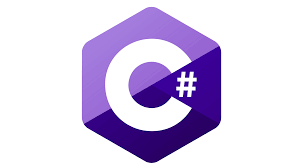
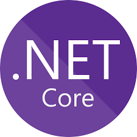
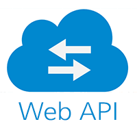
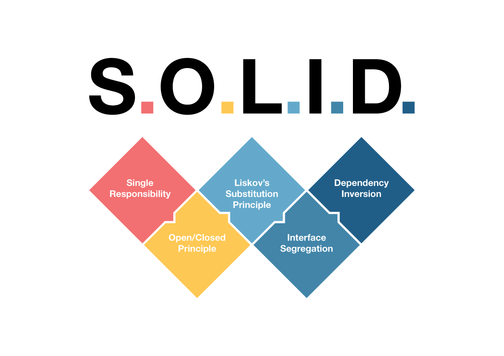
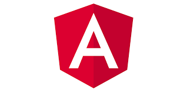
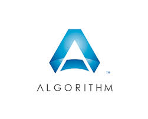

# Topics

| No. | Topic | What it covers |
| --- | ----- | -------------- |
| 1 | [C# & OOP](CsharpOops.md) | OOP pillars, abstract classes, interfaces, arrays, exceptions, keywords |
| 2 | [.NET Fundamentals](DotNetFundamental.md) | CLR, JIT, GC, memory, boxing, collections, threads, delegates, disposal |
| 3 | [ASP.NET Core](DotnetCore.md) | Configuration, dependency injection, middleware, service lifetimes, Kestrel |
| 4 | [Web API](API.md) | REST vs SOAP, HTTP verbs, idempotency, PUT vs PATCH |
| 5 | [Coding Programs](SimpleProgram.md) | String, number and array programs, sorting and searching |
| 6 | [Design Principles](DesignPrinciple.md) | SOLID, YAGNI, KISS, DRY |
| 7 | [Design Patterns](DesignPattern.md) | Gang of Four patterns, microservice patterns |
| 8 | [Software Architect](SoftwareArchitect.md) | Behavioural and experience-based architect questions |
| 9 | [SQL Server](SQLServer.md) | Queries, joins, window functions, indexes, triggers, performance |
| 10 | [Angular](Angular.md) | Components, directives, data binding, routing, lazy loading, DI, life cycle |

<table>
  <tr>
    <td align="center"><a href="#/CsharpOops"> <b>C# & OOP</b></a></td>
    <td align="center"><a href="#/DotNetFundamental"> <b>.NET Fundamentals</b></a></td>
    <td align="center"><a href="#/DotnetCore"> <b>ASP.NET Core</b></a></td>
  </tr>
  <tr>
    <td align="center"><a href="#/API"> <b>Web API</b></a></td>
    <td align="center"><a href="#/DesignPrinciple"> <b>Design Principles</b></a></td>
    <td align="center"><a href="#/SQLServer"> <b>SQL Server</b></a></td>
  </tr>
  <tr>
    <td align="center"><a href="#/Angular"> <b>Angular</b></a></td>
    <td align="center"><a href="#/DesignPattern"> <b>Design Patterns</b></a></td>
    <td align="center"><a href="#/SimpleProgram"> <b>Coding Programs</b></a></td>
  </tr>
</table>
